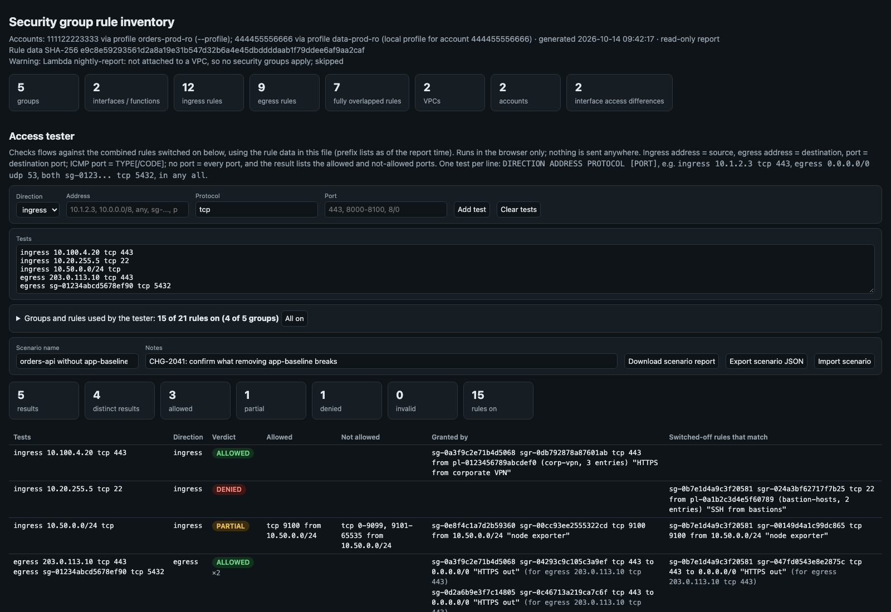
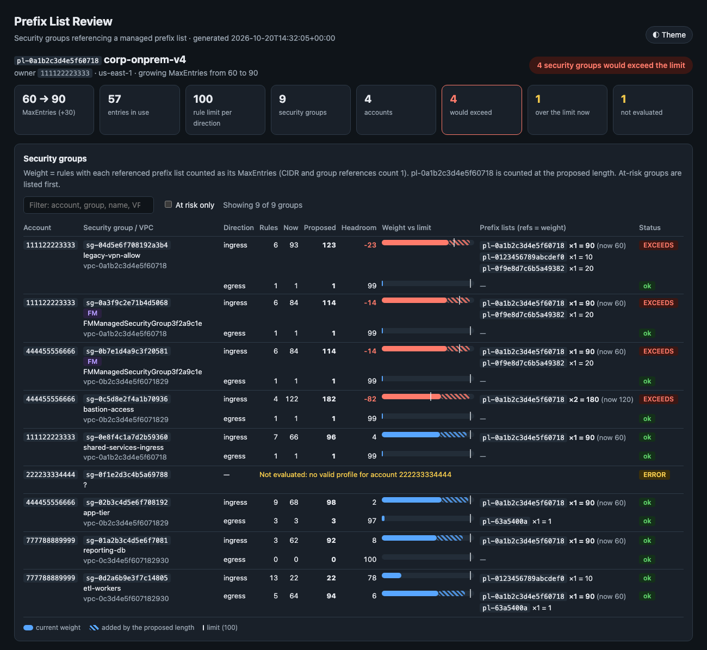

# AWS Network Tools

Command-line tools for investigating AWS networks: tracing paths, finding who owns an address, reviewing
firewall policy, security groups, NACLs and prefix lists, and running centralized VPC endpoints. All but the
`vpce` tools write self-contained HTML reports you can share or attach to a ticket.

## Tools

**Paths and addresses**

| Tool | AWS service | What it does |
|---|---|---|
| [`reachability_trace`](tools/reachability_trace/) | VPC Reachability Analyzer | Create and run traces between any supported source and destination, including across accounts, with ports applied at the source. Reports show every hop and mark exactly where a blocked path breaks |
| [`ipam_locate`](tools/ipam_locate/) | VPC IPAM | Find the account, Region, VPC, subnet and resource behind an IP or CIDR, or the most specific parent pool CIDR, with the full IPAM hierarchy |

**Firewall policy, security groups, NACLs and prefix lists**

| Tool | AWS service | What it does |
|---|---|---|
| [`firewall`](tools/firewall/) (suite of 10) | Firewall Manager, EC2 | Read-only reviews of Firewall Manager policies (rule parity, NACL policy vs live NACLs, compliance, policy snapshots and drift), NACL shadowed rules, security group inventory, access gaps, migration checks and quotas, and prefix list capacity and drift |
| [`pl_review`](tools/pl_review/) | EC2 managed prefix lists | Before growing a managed prefix list: every security group that references it, in any account, and whether the proposed `MaxEntries` would push any of them over the rule quota |

**Centralized VPC endpoints**

| Tool | AWS service | What it does |
|---|---|---|
| [`vpce`](tools/vpce/) (suite of 3) | VPC endpoints, Route 53 | List VPC endpoints with their private hosted zones (`vpce_list`), review PHZ to VPC associations (`phz_review`), and generate the AWS CLI commands to associate or disassociate PHZs and VPCs across accounts (`phz_assoc`) |

The tools work well together. For example:
- Use `ipam_locate` to find who owns an unknown address, then `reachability_trace` to check whether traffic
  can reach it.
- Use `firewall/prefix_list_audit` to find prefix lists near capacity, then `pl_review` to check whether one
  can grow.

| Reachability trace | IPAM locate |
|---|---|
|  |  |
| **Security group access tester** (`firewall/sg_rule_inventory`) | **Prefix list review** (`pl_review`) |
|  |  |

> The screenshots are simulated. They are rendered from synthetic test fixtures and samples (made-up account
> IDs and resource IDs).

## Getting started

Requires Python 3.11+ and AWS credentials.

```bash
git clone <repository-url> && cd <repository-folder>
python3 -m venv .venv && . .venv/bin/activate
pip install -r requirements.txt                       # shared runtime dependencies for every tool
pip install -r tools/vpce/requirements-dev.txt        # optional: pytest and moto, for running the tests

python tools/ipam_locate/ipam_locate.py 10.1.1.25 --profile network-admin --region us-east-1
python tools/reachability_trace/reachability.py types
python tools/firewall/sg_quota_audit.py --help
```

Every tool and suite also has its own `requirements.txt`, so it can be installed on its own. Each README
covers usage, options, output, configuration and IAM permissions.

## Shared conventions

| Area | Convention |
|---|---|
| **Safety** | Nothing changes AWS resources except `reachability_trace`'s `create`, `analyze` and `delete-*` commands. Those are dry-run by default: they log `[DRY-RUN]` with the exact request and need `--execute` or `--apply`. `phz_assoc` only prints the commands for you to review and run |
| **Credentials** | `--profile` (or `AWS_PROFILE`) and `--region` (or `AWS_REGION`) select the account and Region; otherwise the standard boto3 credential chain is used. The `firewall`, `vpce` and `pl_review` tools can also find each account's profile in your local AWS config by account ID. Profiles ending in `-priv` or `-cpar` are never picked automatically, and `pl_review` only uses profiles whose names start with `hcli-` |
| **Configuration** | Each tool or suite reads a `.env` file (see its `.env.example`) from its own directory, or from the nearest parent directory that has one (such as the repository root). The directory you run a tool from doesn't matter. CLI flags override `.env`, which overrides defaults |
| **TLS** | The OS certificate store is used through `truststore` (macOS, Windows, Linux), so corporate TLS inspection works without extra configuration |

Where each tool writes, and what it expects:

| Tool | Output | Variable prefix | Exit codes | Tests |
|---|---|---|---|---|
| `reachability_trace` | HTML in `reports/<date>/<account>/` | `RA_` | 0 ok, 1 error, 2 analysis failed | `python -m pytest tests` |
| `ipam_locate` | HTML in `reports/<date>/<account>/` | `IPAM_` | 0 ok, 1 error | `python -m pytest tests` |
| `firewall/*` | HTML, CSV and JSON in `reports/<tool>/<date>/` | `FMM_`, `SG_`, `PL_` | 0 nothing found, 1 findings, 2 fatal | none yet |
| `pl_review` | HTML, JSON, Markdown and CSV in `reports/<date>/` | `PL_REVIEW_` | 0 ok, 1 at risk, 2 fatal, 3 partly evaluated | `PYTHONPATH=. python tests/test_pl_review.py` |
| `vpce/*` | stdout: table, JSON or CSV (`phz_assoc`: shell script or JSON plan) | `VPCE_` | 0 ok, 1 error, 2 bad input | `python -m pytest` |

The `reports/` root is relative to the current directory and is git-ignored. Run the tests from the tool or
suite directory. They use fixtures, in-memory fakes or moto, so no AWS credentials are needed.

## Repository layout

```text
tools/
├── <tool>/                # a single tool
│   ├── <tool>.py          # CLI entry point
│   ├── *.py               # core logic and rendering (some tools are a single file)
│   ├── requirements.txt   # runtime dependencies (requirements-dev.txt adds test tools)
│   ├── .env.example
│   ├── README.md
│   ├── docs/              # optional: screenshots, and the script and fixtures/samples that render them
│   └── tests/
└── <suite>/               # several tools that share code
    ├── lib/               # shared code
    ├── README.md          # what the suite's tools have in common, with links to each tool's page
    ├── .env.example
    ├── requirements.txt
    └── ...                # the tools, as <tool>.py files (firewall) or <tool>/ folders (vpce)
```

New tools go under `tools/` with the same layout and conventions, plus a row in the tables above.

`firewall` and `vpce` were merged in from the `aws-firewall-tools` and `aws-vpce-tools` repositories with their
history, so `git log --follow` works on their files. `pl_review` came from a standalone project with no version
history.

## License

Free to use, modify and redistribute. All copies and derivative works must credit the author. Commercial use
while supporting clients (consulting, contracting, managed services and similar) requires a separate written
license from the author. See [LICENSE](LICENSE) for the full terms.
