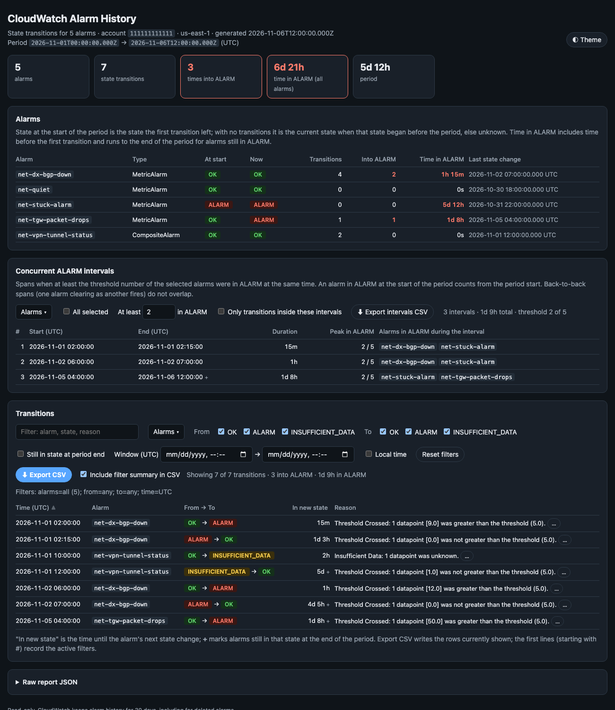

# CloudWatch Alarm History

[](https://github.com/brett6320/aws-net-tools/actions/workflows/tests-cw_alarm_history.yml)   

Captures every state transition of a list of CloudWatch alarms over a time period: when each alarm changed state, from what to what, why, and how long it then stayed in the new state. Writes a self-contained HTML report with in-page filters and a CSV export that honours them. Read-only; it never mutates anything.



> The screenshot is simulated. It's the HTML report rendered from the synthetic alarm set in
> `tests/fake_cloudwatch.py` (made-up account ID and alarm names).

## How it works

1. Resolves the period from `--start` / `--end` / `--last` (default: the last 7 days, ending now).
2. Calls `DescribeAlarms` for the named alarms and every alarm matching an `--alarm-prefix`, to get each alarm's type, current state and when that state began. Named alarms that no longer exist are still queried, since CloudWatch keeps history for deleted alarms; a prefix only matches alarms that exist today.
3. Calls `DescribeAlarmHistory` once per alarm for the period (`StateUpdate` items by default; `ConfigurationUpdate` and `Action` on request), oldest first, and parses the old and new state, reason and evaluation data from each item.
4. Computes how long each new state lasted (until the alarm's next transition, or the end of the period, which marks the row as still in effect), the state at the start of the period (what the first transition left; with no transitions, the current state if it began before the period, else unknown) and per-alarm totals: transitions, times into ALARM, and time in ALARM including the time before the first transition.
5. Writes the HTML report (and CSV / JSON when asked) and prints a summary table.

CloudWatch keeps alarm history for 30 days. A start older than that is accepted but logged as a warning; the history simply comes back empty. An end in the future is capped at now.

## Usage

```bash
# five alarms, last 7 days
python tools/cw_alarm_history/cw_alarm_history.py --profile hcli-network-ro --region us-east-1 \
    --alarm net-dx-bgp-down --alarm net-tgw-packet-drops,net-vpn-tunnel-status

# every alarm whose name starts with net-, for a fixed window, with CSV and JSON too
python tools/cw_alarm_history/cw_alarm_history.py --alarm-prefix net- \
    --start 2026-11-01T00:00Z --end 2026-11-03T00:00Z --formats html,csv,json

# alarms from a file, the 48 hours before yesterday noon, including actions and config changes
python tools/cw_alarm_history/cw_alarm_history.py --alarms-file alarm_sets/network.txt \
    --end 2026-11-05T12:00 --last 48h --history-types all
```

Python API (all kwargs):

```python
from datetime import datetime, timedelta, timezone
from cw_alarm_history import collect_alarm_history

end = datetime.now(timezone.utc)
report = collect_alarm_history(alarms=["net-dx-bgp-down"], prefixes=["net-tgw-"],
                               start=end - timedelta(days=3), end=end,
                               profile="hcli-network-ro", region="us-east-1")
for t in report.transitions:
    print(t.timestamp, t.alarm, t.from_state, "->", t.to_state, t.duration)
```

### Alarm list file

`--alarms-file` takes one alarm name per line. Blank lines and `#` comments are ignored; names are exact and case-sensitive. A copy of this example is in [`alarms.example.txt`](alarms.example.txt); keep your own lists in `alarm_sets/`, which is git-ignored.

```text
# Direct Connect
net-dx-bgp-down-dxcon-abc123
net-dx-bgp-down-dxcon-def456
net-dx-connection-state-dxcon-abc123

# Transit Gateway
net-tgw-packet-drops-blackhole
net-tgw-packet-drops-no-route

# VPN
net-vpn-tunnel-status-vpn-0123456789abcdef0
```

```bash
python tools/cw_alarm_history/cw_alarm_history.py --alarms-file alarm_sets/network.txt --last 7d
```

### Options

| Flag | Description |
|---|---|
| `--alarm NAME`, `-a` | Alarm name; repeat the flag or comma-separate names (`$CWAH_ALARMS`) |
| `--alarms-file FILE` | File with one alarm name per line; blank lines and `#` comments are ignored |
| `--alarm-prefix PREFIX` | Include every alarm whose name starts with PREFIX; repeatable |
| `--start WHEN` | Period start: ISO 8601 (`2026-11-01`, `2026-11-01T14:30Z`, `...+02:00`; a value without a zone is local time) or a duration ago (`36h`, `3d`, `2w`; the signed form needs `--start=-36h`) |
| `--end WHEN` | Period end, same forms (default: now) |
| `--last DURATION` | Window ending at `--end` (default `7d`; not with `--start`). On the command line, `--start` or `--last` overrides both `CWAH_START` and `CWAH_LAST` |
| `--history-types LIST` | `StateUpdate` (default), `ConfigurationUpdate`, `Action`, or `all` |
| `--alarm-types LIST` | `MetricAlarm`, `CompositeAlarm` (default both) |
| `--profile NAME` | AWS profile (default `$AWS_PROFILE`, else the standard credential chain) |
| `--region REGION` | Region of the alarms (default `us-east-1`); alarms are regional, so run once per Region |
| `--out-dir DIR` | Report root (default `reports`); files land in `DIR/<date>/<account>/` |
| `--formats LIST` | Formats to write: `html` (default), `csv`, `json` |
| `--theme THEME` | HTML theme: `dark` (default), `light`, or `auto` (follow the OS); toggle in-page |
| `--json` | Print the JSON report instead of the summary table |
| `--no-write` | Skip writing report files |
| `-v` / `--debug` | Debug logging, including botocore |
| `-q` | Warnings only |

Exit code: `0` ok, `1` at least one alarm's history could not be read (AWS error; the others are still reported), `2` bad input.

## The HTML report

- **Alarms**: one row per alarm with its type, state at the start of the period, current state and when it began, transition counts and time in ALARM. Named alarms that no longer exist are marked `deleted` when they still have history, else `not found`; both are also listed above the cards.
- **Transitions**: one row per state change with the reason CloudWatch gave. The `…` button on a row shows the evaluation data (threshold, datapoints, query date). Columns sort on click. "In new state" is the time until the alarm's next change; `+` marks rows still in effect at the end of the period.
- **Filters**: free text, alarm (multi-select), from-state, to-state, "still in state at period end", a time window, and history type (when more than one was collected). Times show in UTC or local time; the window inputs follow the same choice. "Reset filters" clears everything.
- **Export CSV** writes the rows currently shown, in the current sort order, as `alarm_history_<account>_<timestamp>[_filtered].csv`. When "Include filter summary in CSV" is on (the default), the file starts with `#` lines recording the account, Region, period, every active filter, the row count and the export time, so a filtered extract is self-describing. Columns: `alarm, alarm_type, timestamp_utc, timestamp_<utc|local>_display, from_state, to_state, duration_s, duration, ongoing, reason, account, region, history_type, summary`. `window.cwahCsv()` returns the same name and text (`{name, text}`) from the browser console; the download adds a byte-order mark so Excel reads it as UTF-8.
- The raw report JSON is at the bottom. The page has no external resources, so it can be attached to a ticket as is.

The CSV written with `--formats csv` has the same columns (minus the display timestamp), unfiltered. In both CSVs, cells starting with `=`, `+`, `-` or `@` get a leading `'` so a spreadsheet does not treat an alarm name or reason as a formula.

## Configuration

Flags override `.env`, which overrides defaults. `.env` is read from the tool directory or the nearest parent that has one (see `.env.example`); variables use the `CWAH_` prefix (`CWAH_ALARMS`, `CWAH_ALARMS_FILE`, `CWAH_START`, `CWAH_END`, `CWAH_LAST`, `CWAH_HISTORY_TYPES`, `CWAH_ALARM_TYPES`, `CWAH_OUT_DIR`, `CWAH_FORMATS`, `CWAH_THEME`). `AWS_PROFILE` and `AWS_REGION` select the account and Region. The OS certificate store is used through `truststore`; set `CWAH_NO_TRUSTSTORE=1` to disable that.

## IAM permissions

```json
{
  "Version": "2012-10-17",
  "Statement": [{
    "Effect": "Allow",
    "Action": ["cloudwatch:DescribeAlarms", "cloudwatch:DescribeAlarmHistory", "sts:GetCallerIdentity"],
    "Resource": "*"
  }]
}
```

`sts:GetCallerIdentity` only names the account in the report path and header; without it the report goes under `unknown-account`.

## Tests

```bash
pip install -r requirements-dev.txt
python -m pytest                 # add --cov=. for a coverage report
```

The tests use an in-memory fake of the two CloudWatch calls (`tests/fake_cloudwatch.py`), so no AWS credentials are needed. `docs/make_screenshots.py` regenerates the README screenshots from the same fake with headless Chrome.
