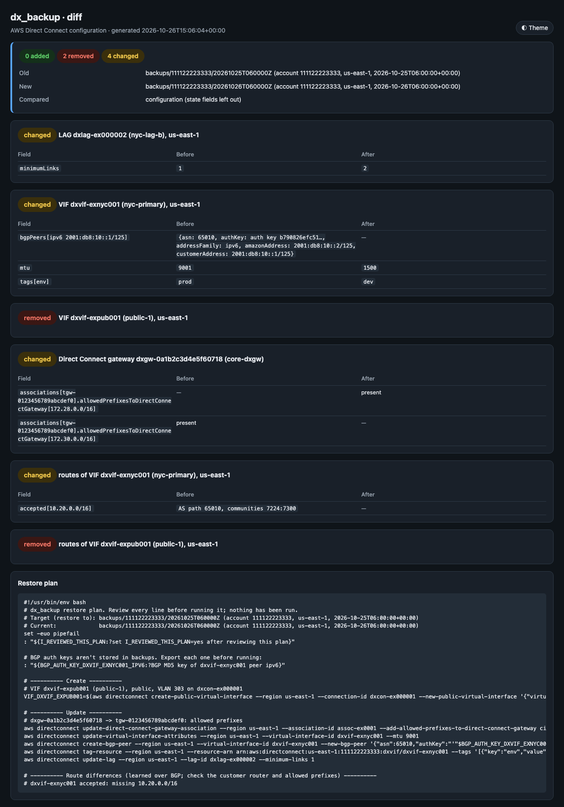
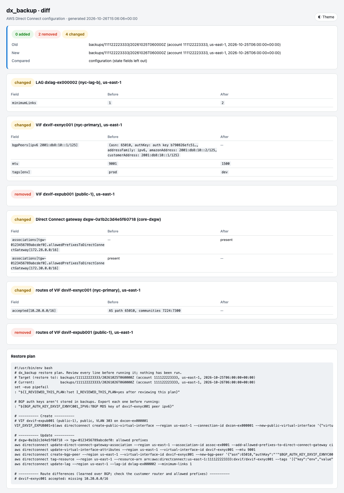

# DX Backup

Back up the configuration of every AWS Direct Connect object in an account, compare backups with each other or
with the live configuration, and generate the AWS CLI commands that would put a backup back. Each backup
covers:

- **Connections and LAGs:** name, location, bandwidth, partner, encryption mode, MACsec key names, minimum
  links, member connections and tags.
- **Virtual interfaces:** type, VLAN, ASNs, addresses, every BGP peer, MTU, SiteLink, rate limit, route filter
  prefixes (public VIFs), the gateway they attach to, and tags.
- **Direct Connect gateways:** name, Amazon side ASN and tags. Also each gateway's associations with their
  allowed prefixes, its VIF attachments (including VIFs owned by other accounts) and pending association
  proposals.
- **Routes:** what each VIF advertises to your router and what it accepts from it, with AS path and
  communities (`ListVirtualInterfaceRoutes`).

The tool is read-only against AWS. `restore-plan` prints commands for you to review and run; it never runs
them.



## Usage

```bash
# Back up one Region (or several with --regions us-east-1,us-west-2)
python dx_backup.py backup --profile network-admin --region us-east-1

# What changed since the backup before? (latest = newest backup, previous = the one before it)
python dx_backup.py diff previous latest

# Has anything changed since the last backup?
python dx_backup.py diff latest              # the second argument defaults to live

# Include operational state too (BGP status, object state, devices)
python dx_backup.py diff latest live --state

# The commands that would bring the live configuration back to a backup
python dx_backup.py restore-plan latest -o restore.sh
python dx_backup.py restore-plan backups/111122223333/20261025T060000Z --against latest
```

A backup can be named by its directory or as `latest` / `previous`. With backups of several accounts in the
same root, add `--account ACCOUNT_ID` to pick that account's newest backups.

### Example: what changed overnight

```text
$ python dx_backup.py diff previous latest
Old: backups/111122223333/20261025T060000Z (account 111122223333, us-east-1, 2026-10-25T06:00:00+00:00)
New: backups/111122223333/20261026T060000Z (account 111122223333, us-east-1, 2026-10-26T06:00:00+00:00)

0 added, 2 removed, 4 changed

~ LAG dxlag-ex000002 (nyc-lag-b), us-east-1
    ~ minimumLinks: 1 -> 2

~ VIF dxvif-exnyc001 (nyc-primary), us-east-1
    - bgpPeers[ipv6 2001:db8:10::1/125]: {asn: 65010, authKey: auth key b790826efc51…, addressFamily: ipv6, ...}
    ~ mtu: 9001 -> 1500
    ~ tags[env]: prod -> dev

- VIF dxvif-expub001 (public-1), us-east-1

~ Direct Connect gateway dxgw-0a1b2c3d4e5f60718 (core-dxgw)
    + associations[tgw-0123456789abcdef0].allowedPrefixesToDirectConnectGateway[172.28.0.0/16]
    - associations[tgw-0123456789abcdef0].allowedPrefixesToDirectConnectGateway[172.30.0.0/16]

~ routes of VIF dxvif-exnyc001 (nyc-primary), us-east-1
    - accepted[10.20.0.0/16]: AS path 65010, communities 7224:7300

- routes of VIF dxvif-expub001 (public-1), us-east-1
```

Lists whose order doesn't matter are matched by a stable key, so a reordered list isn't reported as a
change: BGP peers by address family and customer address, prefixes by CIDR, tags by key, gateway associations
by the associated gateway, attachments by VIF, and routes by prefix. Operational state changes on its own, so
it's left out unless you pass `--state`. That covers BGP status, object state, LOA times, AWS device names,
prefix pool counters and route install times.

### Example: restore plan

```bash
$ python dx_backup.py restore-plan previous --against latest
#!/usr/bin/env bash
# dx_backup restore plan. Review every line before running it; nothing has been run.
# Target (restore to): backups/111122223333/20261025T060000Z (...)
# Current:             backups/111122223333/20261026T060000Z (...)
set -euo pipefail
: "${I_REVIEWED_THIS_PLAN:?set I_REVIEWED_THIS_PLAN=yes after reviewing this plan}"

# BGP auth keys aren't stored in backups. Export each one before running:
: "${BGP_AUTH_KEY_DXVIF_EXNYC001_IPV6:?BGP MD5 key of dxvif-exnyc001 peer ipv6}"

# ---------- Create ----------
# VIF dxvif-expub001 (public-1), public, VLAN 303 on dxcon-ex000001
VIF_DXVIF_EXPUB001=$(aws directconnect create-public-virtual-interface --region us-east-1 --connection-id dxcon-ex000001 --new-public-virtual-interface '{"virtualInterfaceName":"public-1","vlan":303,...}' --query virtualInterfaceId --output text)

# ---------- Update ----------
# dxgw-0a1b2c3d4e5f60718 -> tgw-0123456789abcdef0: allowed prefixes
aws directconnect update-direct-connect-gateway-association --region us-east-1 --association-id assoc-ex0001 --add-allowed-prefixes-to-direct-connect-gateway cidr=172.30.0.0/16 --remove-allowed-prefixes-to-direct-connect-gateway cidr=172.28.0.0/16
aws directconnect update-virtual-interface-attributes --region us-east-1 --virtual-interface-id dxvif-exnyc001 --mtu 9001
aws directconnect create-bgp-peer --region us-east-1 --virtual-interface-id dxvif-exnyc001 --new-bgp-peer '{"asn":65010,"authKey":"'"$BGP_AUTH_KEY_DXVIF_EXNYC001_IPV6"'",...}'
aws directconnect tag-resource --region us-east-1 --resource-arn arn:aws:directconnect:us-east-1:111122223333:dxvif/dxvif-exnyc001 --tags '[{"key":"env","value":"prod"}]'
aws directconnect update-lag --region us-east-1 --lag-id dxlag-ex000002 --minimum-links 1

# ---------- Route differences (learned over BGP; check the customer router and allowed prefixes) ----------
# dxvif-exnyc001 accepted: missing 10.20.0.0/16
```

How each kind of difference is handled:

| Difference | In the plan |
|---|---|
| Direct Connect gateway missing | `create-direct-connect-gateway` with its name, ASN and tags, then its associations. The new gateway ID is captured in a shell variable for the commands after it |
| Association missing, or allowed prefixes differ | `create-direct-connect-gateway-association`, or `update-...-association` with the prefixes to add and remove. If the gateway belongs to another account, a comment gives the proposal command to run from that account |
| VIF missing | `create-{private,transit,public}-virtual-interface` with the full spec (gateway, MTU, SiteLink, tags), plus `create-bgp-peer` for each extra peer |
| VIF name, MTU, SiteLink, rate limit or prefix pool differs | `update-virtual-interface-attributes` |
| BGP peer missing | `create-bgp-peer` |
| Connection or LAG name, encryption mode or minimum links differs | `update-connection` / `update-lag` |
| Tags differ | `tag-resource` / `untag-resource` |
| VLAN, ASN, addresses, connection, gateway or public prefixes differ | A comment: AWS can't change these in place, so the VIF has to be recreated (public VIF prefixes change through AWS Support) |
| BGP peer ASN or auth key differs | A comment with the delete and create commands; replacing a peer drops its BGP session |
| Physical connection or LAG missing | A comment with `create-connection` / `create-lag`: it needs a new cross-connect. A hosted connection has to be provisioned again by the partner |
| Hosted VIF owned by another account | A comment: the connection owner allocates it and that account accepts it |
| Object or peer in the current configuration but not in the backup | A commented-out `delete-...` command. Deletes are never live lines |
| Routes differ | A note per VIF. Routes are learned over BGP, so the fix is on the customer router or in the allowed prefixes |

The plan starts with `set -euo pipefail` and stops unless `I_REVIEWED_THIS_PLAN` is set.

## BGP auth keys

`DescribeVirtualInterfaces` returns each VIF's BGP MD5 key, and its sample router configuration
(`customerRouterConfig`) embeds it too. A backup never stores either one:

- Each key is replaced by `scrypt:` plus an scrypt hash of the key, salted with the VIF ID. scrypt is
  deliberately slow and memory-hard, so guessing keys from a copied backup is expensive. The fingerprint is
  the same in every backup of that VIF, so a diff can still say "auth key changed". Equal keys on different
  VIFs don't share a fingerprint, and a precomputed table won't work.
- `customerRouterConfig` is dropped.
- The diff and the HTML report show a key only as "auth key", "auth key set" or "auth key (changed)".
- The restore plan asks for each key it needs as an environment variable (`BGP_AUTH_KEY_<VIF>_<FAMILY>`) and
  stops if one isn't set.

A short or guessable key can still be guessed against its fingerprint, only slowly, so keep backups where
you would keep other network configuration.

## Backup layout

```text
backups/<account>/<UTC timestamp>/
  manifest.json                   tool, format, time, account, Regions, counts, warnings, SHA-256 per file
  connections/<dxcon-id>.json
  lags/<dxlag-id>.json
  vifs/<dxvif-id>.json
  dx-gateways/<dxgw-id>.json      the gateway, its associations, attachments and proposals
  routes/<dxvif-id>.json          advertised and accepted routes
```

Each object file holds the API response for that object, with the auth key replaced. When a backup is
loaded, every file is checked against the manifest's hash: a file that was edited or is missing is reported
as a warning, and the rest still load. An existing backup is never overwritten. `backups/` is git-ignored.

## Scope

One account per run: the account of `--profile`, in the Regions given by `--region` or `--regions`. Direct
Connect gateways are global, so they're read once. Run the tool once per account to back up several. A VIF
that another account owns but that is attached to one of your gateways appears in the gateway's attachments;
its own configuration is in that account's backup.

`diff ... live` and `restore-plan` (against live) read the live configuration for the same Regions as the
backup, unless you pass `--region` or `--regions`. If the live account isn't the backup's account, the tool
warns.

## HTML report

`diff` also writes a self-contained HTML report to `reports/<YYYY-MM-DD>/<account>/` (or `--output`). It has
the summary, one card per changed object with a Field / Before / After table, and any warnings. Use
`--no-report` to skip it. `--theme dark|light|auto` picks the look (default `dark`; `auto` follows the OS),
and the button in the corner switches it.



## Requirements

- Python 3.11+
- AWS credentials configured (profile, env vars, SSO, or IAM role)
- boto3 1.43.118 or later (BGP route visibility, launched in July 2026)

## Installation

```bash
pip install -r requirements.txt
```

See the [repository README](../../README.md#getting-started) for a shared virtual environment.

## Configuration

Copy `.env.example` to `.env` and fill in values (CLI flags override them). `.env` is read from this tool's
directory, or from the nearest parent directory that has one (such as the repository root). The directory you
run the tool from doesn't matter.

| Variable | Default | Description |
|---|---|---|
| `AWS_PROFILE` | (default chain) | AWS profile name (never written to backups) |
| `DXB_REGION` | `AWS_REGION` / `AWS_DEFAULT_REGION` | Region to read, and the API Region |
| `DXB_REGIONS` | — | Several Regions, comma-separated |
| `DXB_BACKUP_DIR` | `backups` | Backups root |
| `DXB_REPORTS_DIR` | `reports` | Diff reports root |
| `DXB_THEME` | `dark` | Default report theme (`dark`, `light`, `auto`) |

## IAM Permissions

All read-only (plus `sts:GetCallerIdentity`):

```json
{
  "Version": "2012-10-17",
  "Statement": [
    {
      "Effect": "Allow",
      "Action": [
        "directconnect:DescribeConnections",
        "directconnect:DescribeLags",
        "directconnect:DescribeVirtualInterfaces",
        "directconnect:DescribeDirectConnectGateways",
        "directconnect:DescribeDirectConnectGatewayAssociations",
        "directconnect:DescribeDirectConnectGatewayAttachments",
        "directconnect:DescribeDirectConnectGatewayAssociationProposals",
        "directconnect:ListVirtualInterfaceRoutes",
        "sts:GetCallerIdentity"
      ],
      "Resource": "*"
    }
  ]
}
```

Running a restore plan needs the matching write permissions. That is up to you; the tool never runs it.

## Output

- **backup:** prints the backup directory and the object counts (`--json` prints the manifest).
- **diff:** prints the changes (`--json` for JSON) and writes the HTML report.
- **restore-plan:** prints the shell script, or writes it with `-o FILE`.
- **Logs (stderr):** `%(asctime)s %(levelname)s dx_backup — message`. A call that fails (for example, access
  denied on one API) is a warning recorded in the manifest; the rest of the backup continues.
- **Exit codes:** 0 on success (diff: no changes; restore-plan: nothing to do). 1 for bad arguments,
  credential problems or a fatal AWS error. 2 when `diff` finds changes or `restore-plan` has steps.

## Tests

```bash
pip install -r requirements-dev.txt
python -m pytest
```

No AWS credentials are needed. The tests use an in-memory fake of the Direct Connect API with synthetic data,
since `moto` covers only connections and LAGs (no VIFs, gateways or routes).

## Regenerating screenshots

```bash
python docs/make_screenshots.py         # all
python docs/make_screenshots.py diff    # one
```

The images in `docs/images/` are headless-Chrome captures of a diff report built from the test data. This
needs macOS and Google Chrome.

## Platform Notes

- **macOS:** the system PKI truststore is used automatically through Security.framework (`truststore`).
- **Windows:** the Windows Certificate Store is used automatically. Credentials are at
  `%USERPROFILE%\.aws\credentials`.
- **Linux:** the system CA bundle is used through `truststore`. Make sure `ca-certificates` is installed.
