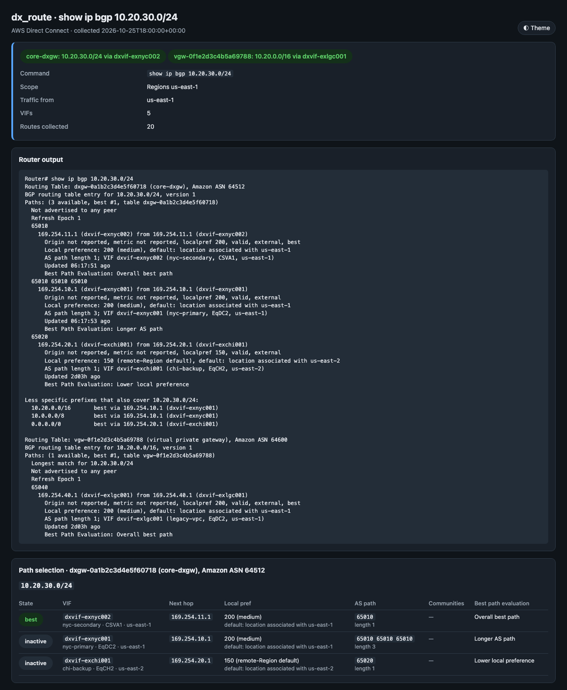
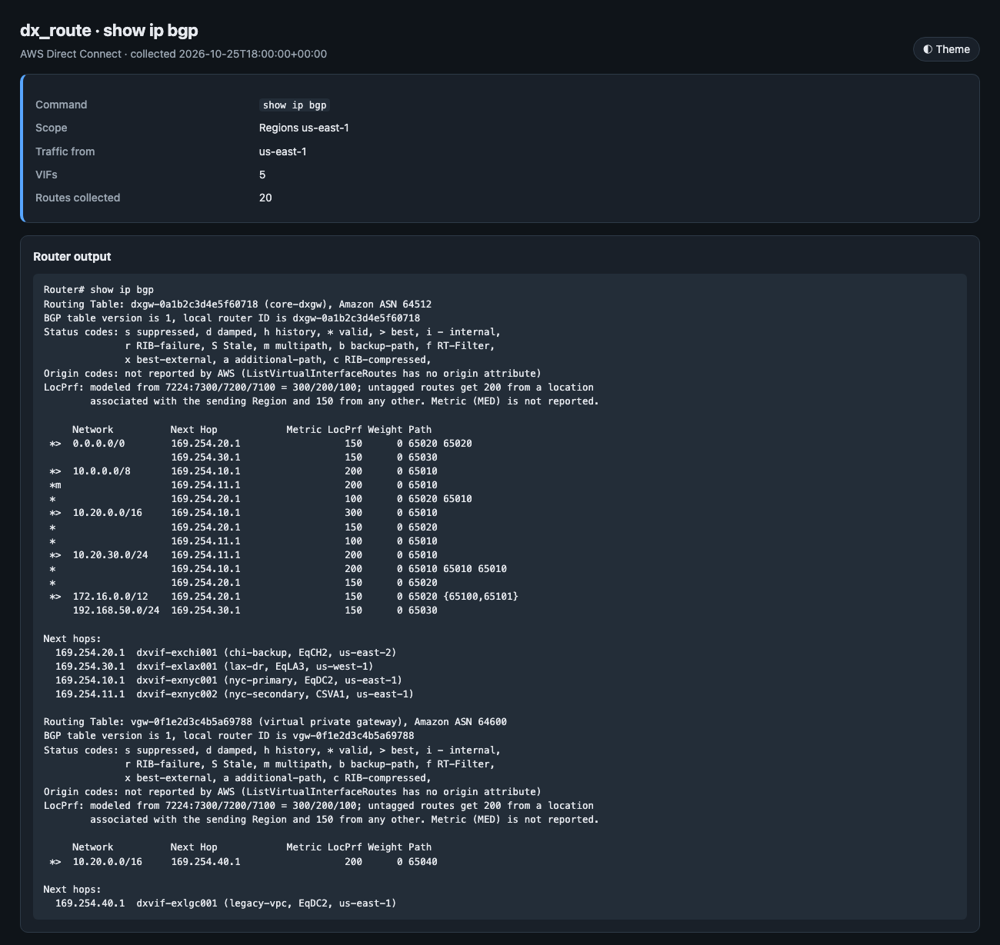
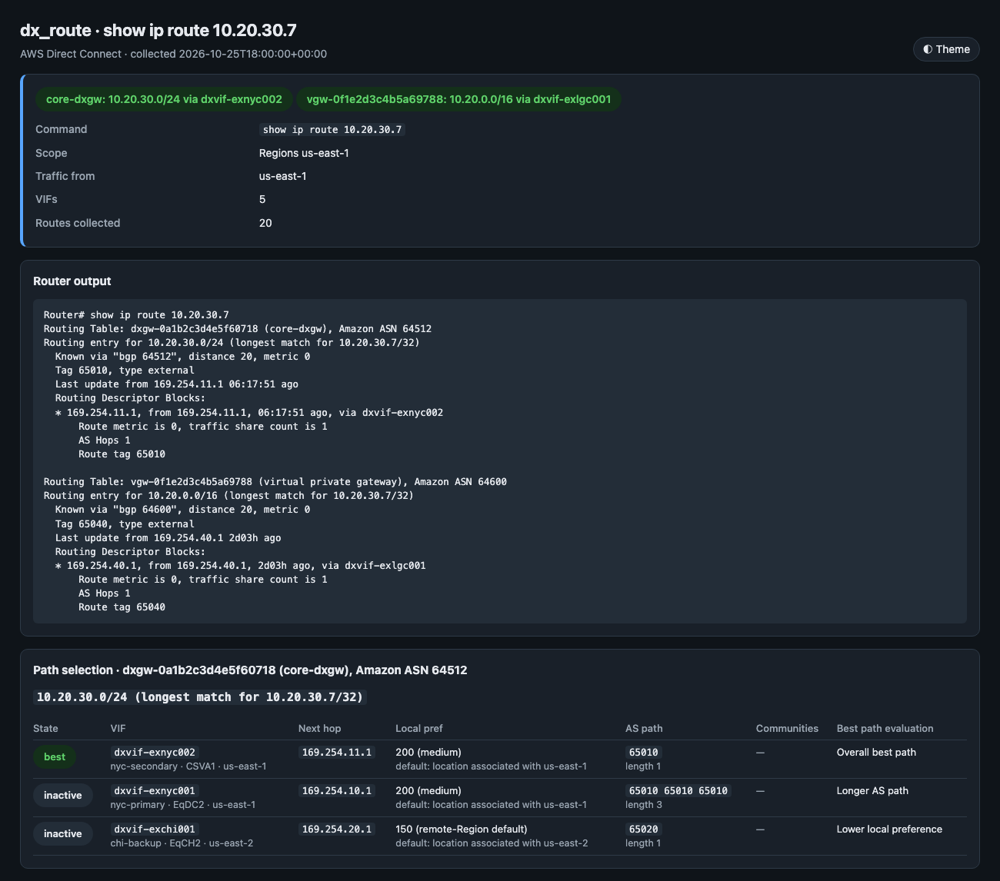
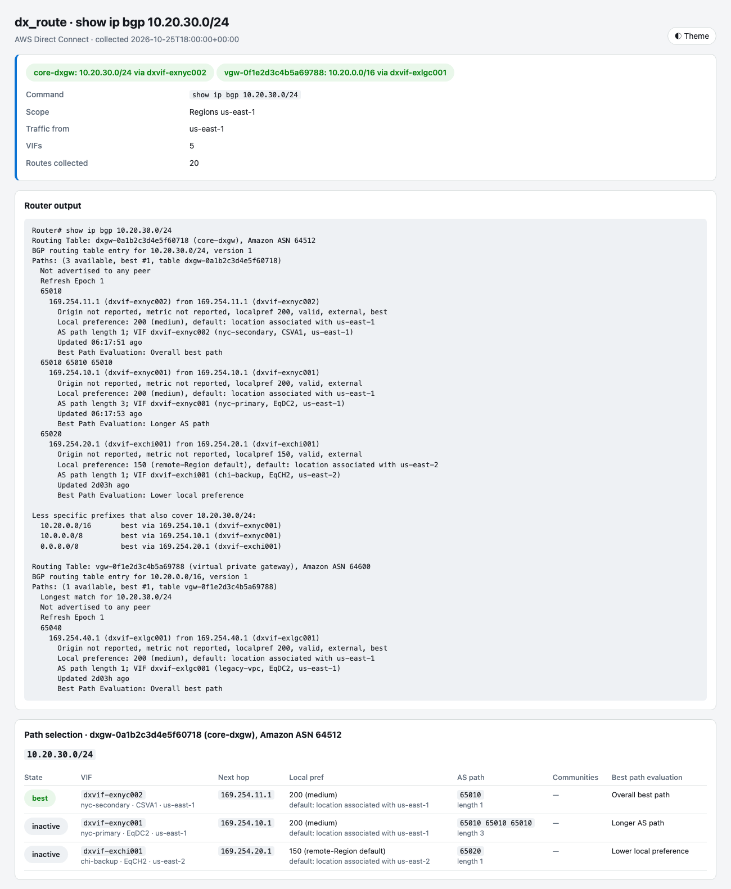

# DX Route

[](https://github.com/brett6320/aws-net-tools/actions/workflows/tests-dx_route.yml)   

A router's `show ip bgp` and `show ip route` for AWS Direct Connect, in Cisco IOS syntax. For any address or
prefix, it shows which virtual interface (VIF) AWS would use to send traffic toward on-premises. It lists the
active and inactive paths, each path's AS path, communities and local preference, and why each losing path lost.

The routes come from Direct Connect's BGP route visibility (`ListVirtualInterfaceRoutes`): every prefix each
VIF has accepted from your router, with its AS path and communities. That API has no "best path" flag, so the
tool applies the selection order AWS documents for private and transit VIFs:

1. **Longest prefix match.**
2. **Local preference.** Set by the community `7224:7300` (high), `7224:7200` (medium) or `7224:7100` (low).
   Without one, a route from a Direct Connect location associated with the sending Region gets medium, and
   any other location gets a lower value.
3. **Shortest AS_PATH** (prepending makes a path less preferred). An AS_SET counts as one.
4. **Lowest MED.** The API doesn't return MED, so paths still tied here are shown as equal-cost.
5. **ECMP** across the paths that are still tied, whatever their home Region.

Public VIFs use longest prefix and AS_PATH, then prefer the home Region; local preference communities don't
apply to them. Paths only compete inside one Direct Connect gateway, virtual private gateway, or a Region's
public VIFs, so each one is shown as its own routing table (like an IOS VRF).



> The screenshots and examples are simulated. They are rendered from the synthetic bundle in
> `tests/fixtures/` (made-up account IDs, resource IDs and addresses).

## Usage

The tool is read-only. Run it with credentials for the account that owns the VIFs, or the Direct Connect
gateway (VIFs owned by other accounts are read with their own profiles; see
[Accounts and profiles](#accounts-and-profiles)).

```bash
# Which path does AWS use for 10.20.30.0/24? Every path, best first, with the reason for each
python dx_route.py show ip bgp 10.20.30.0/24 --dx-gateway dxgw-0a1b2c3d4e5f60718

# Longest match for one address, as a routing-table entry
python dx_route.py show ip route 10.20.30.7 --region us-east-1

# The BGP table, or only the prefixes inside 10.0.0.0/8 (the mask form works too)
python dx_route.py show ip bgp
python dx_route.py show ip bgp 10.0.0.0 255.0.0.0 longer-prefixes

# One line per VIF BGP session, with the number of accepted prefixes
python dx_route.py show ip bgp summary

# What one VIF received from your router, or what AWS advertises to it
python dx_route.py show ip bgp neighbors 169.254.10.1 received-routes
python dx_route.py show ip bgp neighbors dxvif-exnyc001 advertised-routes

# IPv6, one routing table only, and traffic leaving from another Region
python dx_route.py show ipv6 route 2001:db8:100:5::/64
python dx_route.py show ip route vrf dxgw-0a1b2c3d4e5f60718 10.20.30.7
python dx_route.py show ip bgp 10.20.30.0/24 --dx-gateway dxgw-0a1b2c3d4e5f60718 --from-region us-east-2

# Save the data once, then run any command on it offline
python dx_route.py show ip bgp --dx-gateway dxgw-0a1b2c3d4e5f60718 --advertised --json-out core.json
python dx_route.py --from-json core.json show ip bgp 10.20.30.0/24
```

`show` is optional, and `ipv6` works in place of `ip` everywhere:

| Command | What it shows |
|---|---|
| `show ip bgp PREFIX` | The BGP entry for the prefix (exact, or the longest match), with every path and its `Best Path Evaluation` |
| `show ip bgp [PREFIX MASK longer-prefixes]` | The BGP table, with `*>` best, `*m` multipath and `*` valid |
| `show ip bgp summary` | One line per VIF BGP session: neighbor address, ASN, state or prefixes received |
| `show ip bgp neighbors [ADDRESS\|VIF] received-routes` | Routes AWS accepted on the VIF |
| `show ip bgp neighbors [ADDRESS\|VIF] advertised-routes` | Routes AWS advertises on the VIF |
| `show ip route PREFIX` | The routing entry for the longest match, with one routing descriptor block per ECMP path |
| `show ip route [PREFIX MASK longer-prefixes]` | The routing table: valid best paths only |

Add `vrf TABLE` after `ip bgp` or `ip route` to show one routing table (a Direct Connect gateway or virtual
private gateway ID).

### Example: one prefix, three paths

The best path is chosen by AS path length here. The prepended path and the path from a location associated
with another Region lose:

```text
Routing Table: dxgw-0a1b2c3d4e5f60718 (core-dxgw), Amazon ASN 64512
BGP routing table entry for 10.20.30.0/24, version 1
Paths: (3 available, best #1, table dxgw-0a1b2c3d4e5f60718)
  Not advertised to any peer
  Refresh Epoch 1
  65010
    169.254.11.1 (dxvif-exnyc002) from 169.254.11.1 (dxvif-exnyc002)
      Origin not reported, metric not reported, localpref 200, valid, external, best
      Local preference: 200 (medium), default: location associated with us-east-1
      AS path length 1; VIF dxvif-exnyc002 (nyc-secondary, CSVA1, us-east-1)
      Updated 06:17:51 ago
      Best Path Evaluation: Overall best path
  65010 65010 65010
    169.254.10.1 (dxvif-exnyc001) from 169.254.10.1 (dxvif-exnyc001)
      Origin not reported, metric not reported, localpref 200, valid, external
      Local preference: 200 (medium), default: location associated with us-east-1
      AS path length 3; VIF dxvif-exnyc001 (nyc-primary, EqDC2, us-east-1)
      Updated 06:17:53 ago
      Best Path Evaluation: Longer AS path
  65020
    169.254.20.1 (dxvif-exchi001) from 169.254.20.1 (dxvif-exchi001)
      Origin not reported, metric not reported, localpref 150, valid, external
      Local preference: 150 (remote-Region default), default: location associated with us-east-2
      AS path length 1; VIF dxvif-exchi001 (chi-backup, EqCH2, us-east-2)
      Updated 2d03h ago
      Best Path Evaluation: Lower local preference

Less specific prefixes that also cover 10.20.30.0/24:
  10.20.0.0/16       best via 169.254.10.1 (dxvif-exnyc001)
  10.0.0.0/8         best via 169.254.10.1 (dxvif-exnyc001)
  0.0.0.0/0          best via 169.254.20.1 (dxvif-exchi001)
```

The BGP table for the same gateway (the status-code legend is left out here):

```text
Routing Table: dxgw-0a1b2c3d4e5f60718 (core-dxgw), Amazon ASN 64512
BGP table version is 1, local router ID is dxgw-0a1b2c3d4e5f60718

     Network          Next Hop            Metric LocPrf Weight Path
 *>  10.0.0.0/8       169.254.10.1                  200      0 65010
 *m                   169.254.11.1                  200      0 65010
 *                    169.254.20.1                  100      0 65020 65010
 *>  10.20.0.0/16     169.254.10.1                  300      0 65010
 *                    169.254.20.1                  150      0 65020
 *                    169.254.11.1                  100      0 65010
 *>  10.20.30.0/24    169.254.11.1                  200      0 65010
 *                    169.254.10.1                  200      0 65010 65010 65010
 *                    169.254.20.1                  150      0 65020

Next hops:
  169.254.10.1  dxvif-exnyc001 (nyc-primary, EqDC2, us-east-1)
  169.254.11.1  dxvif-exnyc002 (nyc-secondary, CSVA1, us-east-1)
  169.254.20.1  dxvif-exchi001 (chi-backup, EqCH2, us-east-2)
```

And the routing entry for one address inside it:

```text
Routing Table: dxgw-0a1b2c3d4e5f60718 (core-dxgw), Amazon ASN 64512
Routing entry for 10.20.30.0/24 (longest match for 10.20.30.7/32)
  Known via "bgp 64512", distance 20, metric 0
  Tag 65010, type external
  Last update from 169.254.11.1 06:17:51 ago
  Routing Descriptor Blocks:
  * 169.254.11.1, from 169.254.11.1, 06:17:51 ago, via dxvif-exnyc002
      Route metric is 0, traffic share count is 1
      AS Hops 1
      Route tag 65010
```

### What AWS doesn't report

The output keeps IOS's layout, but a few fields don't exist in the Direct Connect API. The tool says so rather
than inventing them:

- **Origin and MED** are printed as "not reported" and left blank in the table.
- **LocPrf** is modeled: 300, 200 and 100 for `7224:7300`, `7200` and `7100`. An untagged route gets 200 from a
  location associated with the sending Region, and 150 from any other. AWS only documents the latter as
  "a lower value", so when the choice comes down to an untagged remote route against a `7224:7100` route, the
  evaluation says the result is assumed.
- **Message counters and session uptime** in `show ip bgp summary` are shown as `-` and `never`. Route ages
  come from each route's install time, relative to when the data was collected.
- **The local router ID** is the gateway ID.

The result is a simulation of AWS's documented rules, not a copy of its forwarding table. When a transit
gateway sits behind the Direct Connect gateway, it then compares this route with its own (static, VPC, VPN,
Connect); that step isn't shown.

## Scope

Pick the VIFs to compare. Routes only compete within one gateway, so a Direct Connect gateway is usually the
right scope.

| Option | VIFs read |
|---|---|
| (default) | Every VIF in `--region` (or each of `--regions`) owned by the caller's account |
| `--dx-gateway DXGW_ID` | Every VIF attached to the Direct Connect gateway, in any Region or account |
| `--vif DXVIF_ID` (repeatable) | Only these VIFs |
| `--from-region REGION` | The Region the traffic leaves from, for the default local preference (default: the first Region read) |

## Accounts and profiles

VIFs on a Direct Connect gateway can belong to other accounts (hosted VIFs, or VIFs in other accounts of your
organization). The tool reads each one with a profile for its owner account:

1. Your own profile, for VIFs in its account.
2. `--account-profile ACCOUNT_ID=PROFILE` (repeatable).
3. Otherwise, the first profile in your local AWS config whose `sso_account_id` or `role_arn` matches the
   account. Profiles ending in `-priv` or `-cpar` are never picked.

A VIF with no profile is listed with the state `NoAccess` and a warning; its routes aren't shown.

## HTML report

Every command writes a self-contained report to `reports/<date>/<scope>/dx-route_<command>.html` (or
`--output FILE.html`; `--no-report` to skip). It has the answer, the router output, a path-selection table for
the longest match in each routing table, the VIFs in scope, warnings, notes on the method and the raw data.

| BGP table | Routing entry |
|---|---|
|  |  |



## Requirements

- Python 3.11+
- AWS credentials configured (profile, env vars, SSO, or IAM role)
- boto3 1.43.118 or later (BGP route visibility, launched in July 2026)

## Installation

```bash
pip install -r requirements.txt
```

See the [repository README](../../README.md#getting-started) for a shared virtual environment.

## Configuration

Copy `.env.example` to `.env` and fill in values (CLI flags override them). `.env` is read from this tool's
directory, or from the nearest parent directory that has one (such as the repository root). The directory you
run the tool from doesn't matter.

| Variable | Default | Description |
|---|---|---|
| `AWS_PROFILE` | (default chain) | AWS profile name (never written to reports) |
| `DXR_REGION` | `AWS_REGION` / `AWS_DEFAULT_REGION` | Region whose VIFs to read, and the API Region |
| `DXR_REGIONS` | — | Several Regions, comma-separated |
| `DXR_FROM_REGION` | the first Region read | Region the traffic leaves from |
| `DXR_DX_GATEWAY` | — | Only this Direct Connect gateway's VIFs |
| `DXR_REPORTS_DIR` | `reports` | Reports root |
| `DXR_THEME` | `dark` | Default report theme (`dark`, `light`, `auto`) |

## IAM Permissions

All read-only, in each account that owns VIFs (plus `sts:GetCallerIdentity`):

```json
{
  "Version": "2012-10-17",
  "Statement": [
    {
      "Effect": "Allow",
      "Action": [
        "directconnect:DescribeVirtualInterfaces",
        "directconnect:DescribeDirectConnectGateways",
        "directconnect:DescribeDirectConnectGatewayAttachments",
        "directconnect:ListVirtualInterfaceRoutes",
        "sts:GetCallerIdentity"
      ],
      "Resource": "*"
    }
  ]
}
```

## Output

- **Router output (stdout):** the command's IOS-style output, one routing table after another.
- **JSON:** `--json` prints the ranked paths for the command's prefixes instead. `--json-out` saves the raw
  bundle for `--from-json`.
- **Logs (stderr):** `%(asctime)s %(levelname)s dx_route — message`. A VIF that can't be read is a warning,
  listed in the report; the rest continue.
- **Exit codes:** 0 on success. 1 for a bad command, credential problems or a fatal AWS error. 2 when a
  prefix lookup finds no route in any routing table (`% Network not in table`).

## Tests

```bash
pip install -r requirements-dev.txt
python -m pytest
```

No AWS credentials are needed. The tests use a synthetic bundle (`tests/fixtures/core_dxgw.json`) and an
in-memory fake of the Direct Connect API, since `moto` doesn't implement `ListVirtualInterfaceRoutes`.

## Regenerating screenshots

```bash
python docs/make_screenshots.py            # all
python docs/make_screenshots.py bgp-table  # one
```

The images in `docs/images/` are headless-Chrome captures of reports rendered from the fixture. This needs
macOS and Google Chrome.

## Platform Notes

- **macOS:** the system PKI truststore is used automatically through Security.framework (`truststore`).
- **Windows:** the Windows Certificate Store is used automatically. Credentials are at
  `%USERPROFILE%\.aws\credentials`.
- **Linux:** the system CA bundle is used through `truststore`. Make sure `ca-certificates` is installed.
