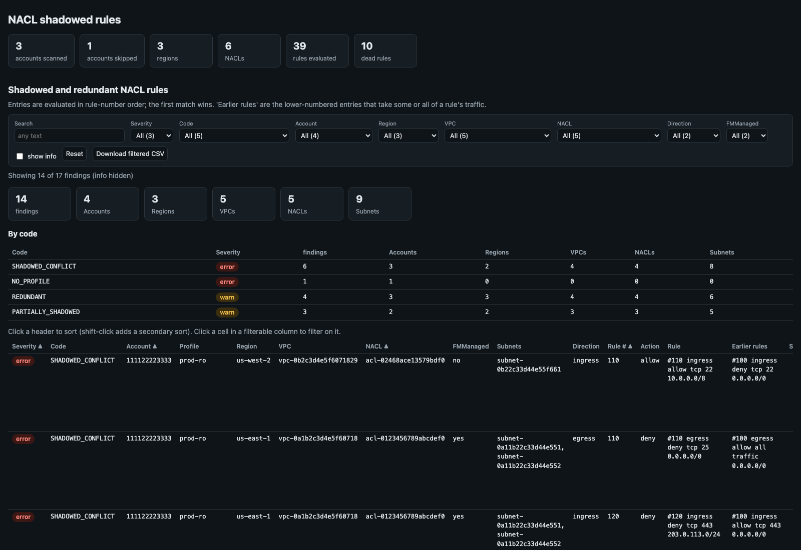
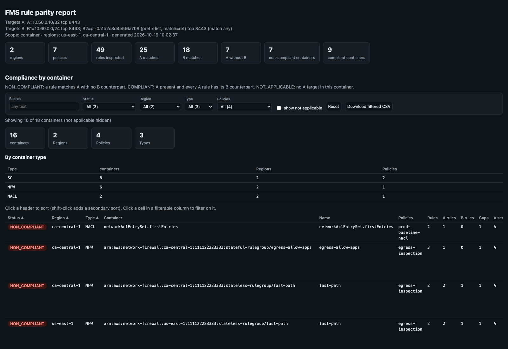

# Firewall Tools

Read-only review tools for AWS Firewall Manager (FMS) policies, network ACLs,
security groups and managed prefix lists. None of them make changes in AWS.

This suite is ten tools that share the code in `lib/`. Each tool has its own
page in [`doc/`](doc/). This page covers what they have in common. For the
other tools in this repository, see the [repository README](../../README.md).

## Tools

**Firewall Manager**

| Tool | Question it answers |
|---|---|
| [`fmm_rule_parity.py`](doc/fmm_rule_parity.md) | Which FMS policy rules allow target A without a matching rule for target B? |
| [`fmm_nacl_audit.py`](doc/fmm_nacl_audit.md) | Do the live NACLs in FMS member accounts carry the policy's first/last rules, and are any near the rule limit? |
| [`fmm_compliance.py`](doc/fmm_compliance.md) | What does Firewall Manager itself report as non-compliant, per policy, member account and resource, and why? |
| [`fmm_policy_snapshot.py`](doc/fmm_policy_snapshot.md) | What changed in our FMS policies since the last snapshot, and do regions that should match actually match? |

**Network ACLs, security groups and prefix lists**

| Tool | Question it answers |
|---|---|
| [`nacl_shadow.py`](doc/nacl_shadow.md) | Which NACL rules can never take effect, or are partly overridden, because an earlier rule already matches their traffic? |
| [`sg_rule_inventory.py`](doc/sg_rule_inventory.md) | What do these security groups (or the groups on interfaces, EC2 instances or Lambda functions, across accounts) allow, together? How do several interfaces differ? Would a given flow be allowed, and what if a rule or group were removed? (interactive tester in the HTML report) |
| [`sg_migration_check.py`](doc/sg_migration_check.md) | Before removing an old security group for a new one: where is the old attached, is the new attached there too, and what access does each resource lose or gain? |
| [`sg_access_gap.py`](doc/sg_access_gap.md) | What access does one security group grant that one or more others, combined, do not? |
| [`sg_quota_audit.py`](doc/sg_quota_audit.md) | Which security groups and network interfaces are at or near their quotas, and which groups are stale, unattached, or default groups with rules? |
| [`prefix_list_audit.py`](doc/prefix_list_audit.md) | Are managed prefix lists full, unused, oversized for the security group rule quota, or different between same-named copies? |

| Security group rule inventory | NACL shadowed rules | FMS rule parity |
|---|---|---|
|  |  |  |

> The screenshots are simulated. They're the real reports rendered from the synthetic samples in
> [`docs/samples/`](docs/samples/) (made-up account and resource IDs). Each tool's page shows its own report.

**Contents:** [Getting started](#getting-started) ·
[Configuration](#configuration) · [Accounts and profiles](#accounts-and-profiles) ·
[Reports](#reports) · [Exit codes](#exit-codes) · [Layout](#layout) ·
[Regenerating screenshots](#regenerating-screenshots)

---

## Getting started

Requires Python 3.11+ and AWS credentials (local AWS profiles). Set up the
shared virtual environment as described in the
[repository README](../../README.md#getting-started), or install this suite on
its own:

```bash
pip install -r tools/firewall/requirements.txt
cp tools/firewall/.env.example tools/firewall/.env   # optional defaults, see Configuration
```

Every tool has `--help`:

```bash
python tools/firewall/fmm_compliance.py --help
```

The tools are also executable (`./fmm_compliance.py` from this directory) when
the virtual environment is active.

TLS uses the operating system's trust store (`truststore`):
- macOS: Security.framework.
- Windows: the Certificate Store.
- Linux: the system CA bundle (install `ca-certificates`).

## Configuration

Settings come from `.env` (see [`.env.example`](.env.example)); command-line
flags override them. `.env` is read from this directory, or from the nearest
parent directory that has one (such as the repository root). The directory you
run a tool from doesn't matter.

| Variable | Used by | Meaning |
|---|---|---|
| `AWS_PROFILE` | all | Default AWS profile (`--profile` overrides). `sg_rule_inventory`, `sg_access_gap` and `sg_migration_check` use it only when no ARN names an account; otherwise each ARN's account uses its own local profile |
| `AWS_REGION` | all | Default region (`--region` overrides) |
| `FMM_REPORT_DIR` | all | Base directory for saved reports (default `./reports`) |
| `FMM_ADMIN_ACCOUNT` | `fmm_*` | FMS administrator (security) account id; its profile is found by account id |
| `FMM_SNAPSHOT_DIR` | `fmm_policy_snapshot` | Where policy snapshots are saved (default `./snapshots`) |
| `FMM_NACL_LIMIT` / `FMM_NACL_HEADROOM` | `fmm_nacl_audit` | NACL rules-per-direction limit (30) and warning headroom (3) |
| `SG_RULE_LIMIT` / `SG_PER_ENI_LIMIT` | `sg_quota_audit` | Quota overrides (default: looked up in Service Quotas, else 60 / 5) |
| `SG_RULE_HEADROOM` / `SG_ENI_HEADROOM` | `sg_quota_audit` | Warning headroom (5 rules / 1 group) |
| `PL_HEADROOM` / `PL_FULL_PCT` | `prefix_list_audit` | Flag lists within N entries (2) or at P% (90) of their maximum |

## Accounts and profiles

The `fmm_*` tools read Firewall Manager through the **FMS administrator
account**. Its profile is chosen in this order:
1. `--profile`
2. the local profile for `FMM_ADMIN_ACCOUNT` / `--admin-account`
3. `AWS_PROFILE`

Tools that look inside member accounts scan the accounts you select:
- `fmm_nacl_audit` uses the accounts in each policy's scope.
- `nacl_shadow`, `sg_quota_audit` and `prefix_list_audit` scan:
  - `--profile`'s account by default;
  - `--account ID[,ID]` for specific accounts;
  - `--all-accounts` for every account with a local profile.
- `sg_rule_inventory`, `sg_access_gap` and `sg_migration_check` read the accounts named in their ARNs, each through its local profile (`--profile` is used for its own account).

Each account's profile comes from the local AWS config (`AWS_CONFIG_FILE` is honoured):
- A profile's account is its `sso_account_id`, `aws_account_id`, or the account in its `role_arn`.
- Profiles ending in `-priv` or `-cpar` are never used (`--exclude-profile-suffix` to change).
- If several profiles match, the first alphabetically is used, with a warning. `--account-profile ACCOUNT=PROFILE` forces one.
- Every profile is checked with `sts:GetCallerIdentity` before use. An account without a usable profile is reported as a finding and skipped by the account-scanning tools (`fmm_nacl_audit`, `nacl_shadow`, `sg_quota_audit`, `prefix_list_audit`); the security group tools stop (exit 2) instead.

## Reports

Each run prints a text report and saves files under
`reports/<tool>/YYYY-MM-DD/HHMMSS_<slug>.*`. The paths are printed at the end of
the text report, and `reports/` is gitignored.

```
reports/
├── fmm_nacl_audit/2026-10-22/230112_nacl_<policy>.{html,csv,json}
├── sg_quota_audit/2026-10-22/231540_sgquota_<accounts>.{html,csv,json}
└── ...
```

Common output flags (every tool; `fmm_policy_snapshot snapshot` only writes the snapshot):

| Flag | Effect |
|---|---|
| `--out-dir DIR` | Base directory instead of `./reports` (env `FMM_REPORT_DIR`) |
| `--no-save` | Don't save files |
| `--html-out` / `--csv-out` / `--json-out PATH` | Write that file to a specific path |
| `--json` | Print JSON instead of the text report |
| `-v` / `-q` | Debug / warnings-only logging |

**HTML reports** are single self-contained files (data embedded, no external
assets, light/dark aware), safe to attach or email. Most are interactive:
- free-text search, filter dropdowns that show counts, and click-a-cell filtering
- unique counts (accounts, regions, policies, VPCs, NACLs ...) for the current filter, plus a summary table
- multi-column sort (shift-click a header) and "Download filtered CSV"
- info-level rows hidden until ticked
- the current view kept in the URL fragment, so it can be bookmarked

The `sg_access_gap` report is a static page laid out per direction. The
`sg_rule_inventory` report adds an access tester that runs in the browser.
Long list cells can show one item per line (table option `lines`).

## Exit codes

| Code | Meaning |
|---|---|
| `0` | Nothing found |
| `1` | Findings: gaps, errors or warnings |
| `2` | Fatal error: bad input, wrong account, or AWS failure that stops the run |

This makes the tools usable in scripts and CI. Some tools define "findings"
more precisely, as described on their pages. For example:
- `sg_rule_inventory` exits 1 when the interfaces given differ;
- `sg_migration_check` exits 0 only when every resource is `READY`.

## Layout

```text
fmm_compliance.py       FMS-reported compliance per policy, account and resource
fmm_nacl_audit.py       live NACLs vs FMS NACL policy
fmm_policy_snapshot.py  FMS policy snapshots, diffs and region comparison
fmm_rule_parity.py      FMS policy rule parity (A present, B missing)
nacl_shadow.py          NACL rules hidden by earlier rules
prefix_list_audit.py    managed prefix list capacity, usage and drift
sg_access_gap.py        left SG access absent from right SG(s)
sg_migration_check.py   old -> new security group migration: attachments and access change per resource
sg_quota_audit.py       security group / interface quotas and clean-up candidates
sg_rule_inventory.py    rules of groups / interfaces / instances / Lambdas, combined access, interface differences, access tester
doc/                    one page per tool
docs/                   make_screenshots.py, samples/ (synthetic report data) and images/
lib/accounts.py         account -> profile mapping, account selection, admin profile
lib/aws_common.py       AWS sessions/clients, FMS policy calls, regions; loads .env, logging
lib/boxes.py            protocol x port x address range arithmetic (SG / NACL comparisons)
lib/html_report.py      self-contained interactive HTML report renderer
lib/output.py           common output flags, report paths and writers
lib/security_groups.py  group / interface / instance / Lambda ids and ARNs, per-account profiles, loading rules and prefix lists
.env.example            configuration template
requirements.txt        runtime dependencies (same as the repository's)
```

The suite has no automated tests yet.

## Regenerating screenshots

```bash
python docs/make_screenshots.py                  # all
python docs/make_screenshots.py nacl-shadow      # one
```

Each `docs/samples/<tool>.py` builds made-up input data and, wherever the tool's code allows, runs it
through the tool's own analysis before calling its `render_html()`. `sg_quota_audit` reads AWS directly while
it scans, so its sample builds the report rows directly, using the tool's thresholds and wording. The images in
`docs/images/` are headless-Chrome captures at 1600px, the reports' maximum width. This needs macOS and
Google Chrome.
