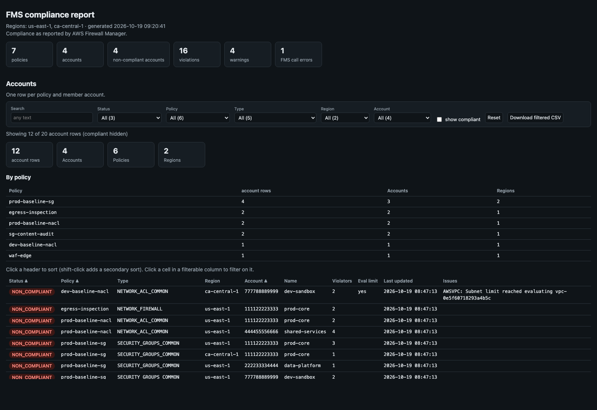

[← Index](../README.md)

# fmm_compliance

Reports what AWS Firewall Manager (FMS) itself flags as non-compliant: per
policy, per member account and per resource, with FMS's reason.



> The screenshot is simulated: it's the real report rendered from the synthetic sample in
> [`docs/samples/fmm_compliance.py`](../docs/samples/fmm_compliance.py) (made-up account and resource IDs).

Use it as the ground truth to set against this suite's own audits
([fmm_nacl_audit](fmm_nacl_audit.md), [fmm_rule_parity](fmm_rule_parity.md)),
and as a work list for remediation. Where FMS and the audits disagree, that is
worth a look in itself.

## Usage

```bash
# Every policy in one region
./fmm_compliance.py --region us-east-1

# NACL policies in every FMS region, with account names from AWS Organizations
./fmm_compliance.py --all-regions --type NETWORK_ACL_COMMON --org-names

# One policy, one member account
./fmm_compliance.py --policy prod-baseline-sg --account 111122223333
```

The FMS administrator profile is chosen as for
[fmm_nacl_audit](fmm_nacl_audit.md#accounts-and-profiles): `--profile`, then
`FMM_ADMIN_ACCOUNT` / `--admin-account` (profile found by account id and
verified with `sts:GetCallerIdentity`), then `AWS_PROFILE`. Member accounts
need no local profiles: everything is read through the administrator account.

## How it works

1. Lists the FMS policies in each region (`--policy` and `--type` narrow it).
2. Records each policy's settings:
   - type
   - remediation on or off
   - resource types
   - whether unused FMS-managed resources are deleted
   - whether include / exclude maps are set
3. Reads the policy's compliance per member account
   (`fms:ListComplianceStatus`):
   - compliant or not
   - violator count
   - whether the evaluation limit was hit
   - last update
   - issues, such as AWS Config not enabled
4. For each non-compliant account (or every account with `--details-all`), reads
   the violating resources and the reason for each
   (`fms:GetComplianceDetail`).

An account is `NON_COMPLIANT` when any of its evaluation results is,
`COMPLIANT` when all are, and `UNKNOWN` when FMS has no result. A failed call
is reported as `FMS_ERROR` and the run carries on with the remaining policies
and accounts.

## Options

| Flag | Description |
|---|---|
| `--profile NAME` | FMS administrator profile; overrides `--admin-account` |
| `--admin-account ID` | FMS administrator account (env `FMM_ADMIN_ACCOUNT`) |
| `--account-profile ACCT=PROFILE` | Force the profile used for the administrator account |
| `--exclude-profile-suffix LIST` | Profile suffixes never used (default `-priv,-cpar`) |
| `--region REGION` | Region(s): repeatable and/or comma-separated (default `AWS_REGION` or `us-east-1`) |
| `--all-regions` | Every enabled region that offers Firewall Manager |
| `--policy ID_OR_NAME` | Only this policy |
| `--type TYPE` | Only policies of this type, e.g. `SECURITY_GROUPS_COMMON`, `NETWORK_ACL_COMMON` (repeatable / comma-separated, case-insensitive) |
| `--account ID` | Only these member accounts (repeatable / comma-separated) |
| `--details-all` | Read violation details for compliant accounts too (default: non-compliant only) |
| `--org-names` | Name accounts from AWS Organizations; skipped with a warning if not permitted |

Common output flags: see [Reports](../README.md#reports).

## Findings

| Code | Severity | Meaning |
|---|---|---|
| `VIOLATION` | error | A resource FMS reports as violating the policy, with FMS's reason (e.g. `RESOURCE_MISSING_SECURITY_GROUP`, `INVALID_NETWORK_ACL_ENTRY`) |
| `FMS_ERROR` | error | A Firewall Manager call failed for a region, policy or account; the rest of the run continues |
| `NON_COMPLIANT_NO_DETAIL` | warn | FMS reports the account non-compliant but returned no violating resources (for example, the detail has expired) |
| `EVALUATION_LIMIT_EXCEEDED` | warn | FMS evaluated only part of the account's resources, so the violator list may be incomplete |
| `ISSUE` | warn | An issue FMS records for the account, keyed by the dependent service (e.g. `AWSCONFIG`) |

Exit codes:
- `0`: every account is compliant and there are no warnings.
- `1`: any violation, warning or call error.
- `2`: a fatal error. That means bad arguments, an administrator profile in the wrong account, policies that couldn't be listed in any region, or a `--policy` that matches nothing.

## Output

- **Text**: totals, then a line per policy (remediation, compliant / non-compliant accounts, violators), then each non-compliant account's violations grouped by reason (first 10 resources per reason), then issues.
- **CSV**: one row per violation or issue. Columns: `severity, code, region, policy_name, policy_id, policy_type, account, account_name, resource_type, resource_id, reason, metadata, detail`.
- **JSON**: `{stats, regions, policies, accounts, violations, issues}`.
- **HTML**: three interactive tables.
  - *Accounts*: one row per policy and member account. Compliant rows are hidden until "show compliant" is ticked.
  - *Violations*: unique counts of accounts, policies, resource types and resources, plus a summary by reason.
  - *Issues*: only when there are any.

## IAM permissions

FMS administrator profile: `sts:GetCallerIdentity`, `fms:ListPolicies`,
`fms:GetPolicy`, `fms:ListComplianceStatus`, `fms:GetComplianceDetail`,
`ec2:DescribeRegions` (for `--all-regions`), and optionally
`organizations:ListAccounts` (for `--org-names`).
