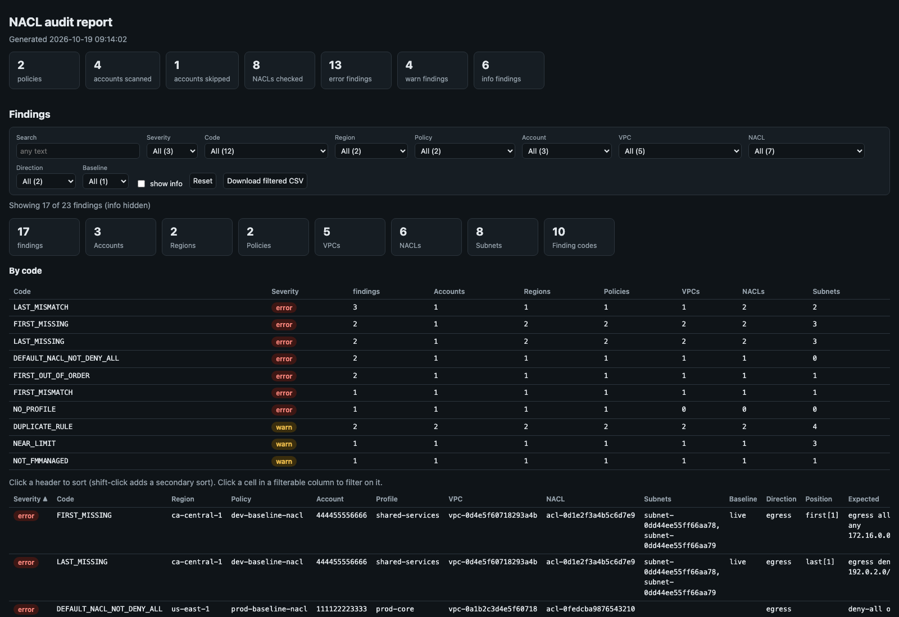

[← Index](../README.md)

# fmm_nacl_audit

Checks the live network ACLs in FMS member accounts against Firewall Manager
`NETWORK_ACL_COMMON` policies.



> The screenshot is simulated: it's the real report rendered from the synthetic sample in
> [`docs/samples/fmm_nacl_audit.py`](../docs/samples/fmm_nacl_audit.py) (made-up account and resource IDs).

How a run works:
1. Asks FMS which member accounts are in scope for each policy (`fms:ListComplianceStatus`).
2. Picks a local AWS profile for each of those accounts.
3. Finds the subnets that match the policy's tag scope, and the NACLs attached to them.
4. Checks each of those NACLs.

## What it checks

- **First / last rules.** Per direction, the lowest-numbered live entries must equal the policy's `FirstEntries`, and the highest-numbered entries below the `*` default must equal its `LastEntries`, in order. Compared: action, protocol, CIDR, port range, ICMP type/code.
- **Rule-count limit.** A direction with `--limit` rules or more is flagged; so is one within `--headroom` of it. The defaults are 30, the raised quota (AWS default is 20), and 3, so 27+ rules is flagged. FMS remediation temporarily adds rules, so headroom matters.
- **Duplicate rules.** The same action, protocol, CIDR, ports and ICMP at more than one rule number in a direction. Only the lowest-numbered copy is ever evaluated; the rest waste slots.
- **Default NACLs.** VPC default NACLs are never checked against the policy, even with `--nacl-scope all`. They must hold only the `*` deny-all rules. The finding lists any subnets still attached.
- **Tagging.** In-scope NACLs should be tagged `FMManaged=true`.

## Usage

```bash
# All NACL policies in a region; expected rules from the live FMS policy
./fmm_nacl_audit.py --profile fms-admin --region us-east-1

# Expected rules from a policy file (accounts still come from FMS)
aws fms get-policy --policy-id <id> --profile fms-admin > prod-nacl.json
./fmm_nacl_audit.py --policy-file prod-nacl.json

# Also diff the file against the live policy, and check NACLs against both
./fmm_nacl_audit.py --policy-file prod-nacl.json --compare-live

# Flag only NACLs at the limit (no headroom)
./fmm_nacl_audit.py --headroom 0
```

## Policies and regions

- FMS policies are regional. Each policy's member accounts are scanned only in that policy's region.
- A policy file's `PolicyArn` sets the region and wins over `--region`.
- Without a `PolicyArn`, the policy is looked up in every `--region` given (or `--all-regions`). The run stops if it's found in none or in more than one.
- A `--policy` that matches nothing is a fatal error, not a clean pass.
- A policy file may be any of:
  - `aws fms get-policy` output
  - the bare `Policy` object
  - a bare `NetworkAclEntrySet`
- Rules are read from `SecurityServicePolicyData.PolicyOption.NetworkAclCommonPolicy.NetworkAclEntrySet` (`FirstEntries` / `LastEntries`). A policy with neither is a fatal error.
- The file's policy is located in FMS by `--policy`, else by its `PolicyId` / `PolicyName`.
- Tag scope (`ResourceTags`) comes from the file when present, else from the live policy.

## Accounts and profiles

**FMS administrator account:** set it in `.env` as
`FMM_ADMIN_ACCOUNT=123456789012` (or pass `--admin-account`). Its profile is
found by account id, like member accounts. Precedence: `--profile`, then
`FMM_ADMIN_ACCOUNT` / `--admin-account`, then `AWS_PROFILE`.

**Member accounts** are mapped to profiles from the local AWS config
(`AWS_CONFIG_FILE` is honoured):
- A profile's account is its `sso_account_id`, `aws_account_id`, or the account in its `role_arn`.
- Profiles ending in `-priv` or `-cpar` are never used (`--exclude-profile-suffix` to change).
- If several profiles match, the first alphabetically is used, with a warning. Force one with `--account-profile 123456789012=my-profile`.
- Every profile is verified with `sts:GetCallerIdentity` before use. A mismatch is reported and the account is not scanned.
- Accounts with no matching profile are reported as `NO_PROFILE`.

## Options

| Flag | Description |
|---|---|
| `--admin-account ID` | FMS administrator account (env `FMM_ADMIN_ACCOUNT`) |
| `--profile NAME` | FMS administrator profile; overrides `--admin-account` |
| `--region` / `--all-regions` | As for [`fmm_rule_parity`](fmm_rule_parity.md) |
| `--policy ID_OR_NAME` | Only this policy (also locates a policy file's policy) |
| `--policy-file PATH` | Expected rules from this file instead of the live policy |
| `--compare-live` | With `--policy-file`: diff file vs live policy and check NACLs against both |
| `--account ID` | Only these account(s); repeatable / comma-separated |
| `--account-profile ACCT=PROFILE` | Force the profile for an account (repeatable) |
| `--exclude-profile-suffix LIST` | Profile suffixes never used (default `-priv,-cpar`) |
| `--nacl-scope subnets\|fmmanaged\|all` | Check NACLs on subnets in the policy's tag scope (default), NACLs tagged `FMManaged=true`, or all non-default NACLs |
| `--limit N` | Rules-per-direction limit (default 30, env `FMM_NACL_LIMIT`) |
| `--headroom N` | Also flag NACLs within N rules of the limit (default 3, env `FMM_NACL_HEADROOM`) |
| `--show-info` | Show info findings in the text report |

Plus the [common output flags](../README.md#reports).

## Findings

| Code | Severity | Meaning |
|---|---|---|
| `FIRST_MISSING` / `LAST_MISSING` | error | Too few entries in that direction to hold the block |
| `FIRST_MISMATCH` / `LAST_MISMATCH` | error | The entry in that position differs (field differences listed) |
| `FIRST_OUT_OF_ORDER` / `LAST_OUT_OF_ORDER` | error | The expected entry exists, but at another rule number |
| `DEFAULT_NACL_NOT_DENY_ALL` | error | VPC default NACL has a rule other than `*` deny all |
| `NO_PROFILE`, `PROFILE_ACCOUNT_MISMATCH`, `ACCOUNT_ERROR`, `FMS_ERROR` | error | Account or FMS could not be checked |
| `AT_LIMIT` / `NEAR_LIMIT` | warn | Rule count at the limit / within headroom |
| `DUPLICATE_RULE` | warn | Identical rule at several rule numbers; `actual` shows the rule and its numbers |
| `NOT_FMMANAGED` | warn | In-scope NACL lacks `FMManaged=true` |
| `POLICY_DRIFT` | warn / info | Policy file differs from the live policy (`--compare-live`) |
| `FIRST_RENUMBERED` / `LAST_RENUMBERED` | info | Correct and in order, but not at FMS's initial numbers (1… / …32766) |
| `CUSTOM_OUTSIDE_RANGE` | info | Rule matching no policy rule, numbered outside the 5000–32000 custom range |

Each finding's `baseline` is `file`, `live` or `file-vs-live`.

## Output

- **Text**: findings grouped by region / policy / account / NACL; info findings only with `--show-info`.
- **CSV / JSON**: every finding (`{stats, findings}` in JSON).
- **HTML**: run totals, then one interactive findings table.
  - Filters: severity, code, region, policy, account, VPC, NACL, direction, baseline.
  - Unique counts of accounts, regions, policies, VPCs, NACLs and subnets, plus a per-code summary.
  - Info findings are hidden until "show info" is ticked.

## IAM permissions

- FMS admin profile: `sts:GetCallerIdentity`, `fms:ListPolicies`, `fms:GetPolicy`, `fms:ListComplianceStatus`, and `ec2:DescribeRegions` (for `--all-regions`).
- Member-account profiles: `sts:GetCallerIdentity`, `ec2:DescribeNetworkAcls`, `ec2:DescribeSubnets`.
