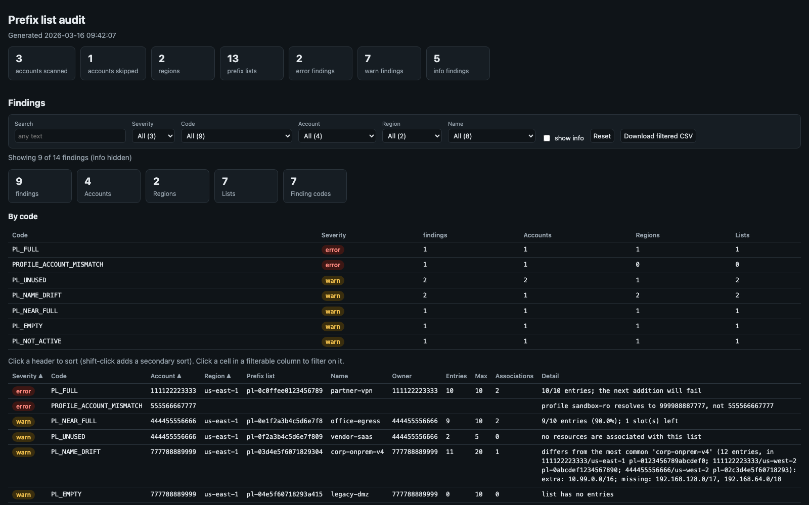

[← Index](../README.md)

# prefix_list_audit

Audits managed prefix lists across accounts and regions: room to grow, actual
use, sizing, overlapping entries, and drift between same-named copies.



> The screenshot is simulated: it's the real report rendered from the synthetic sample in
> [`docs/samples/prefix_list_audit.py`](../docs/samples/prefix_list_audit.py) (made-up account and resource IDs).

**Why it matters.** Managed prefix lists are shared building blocks for
security groups, route tables and Firewall Manager policies:
- A full list blocks the next change.
- An unused list is clutter.
- An oversized list quietly uses up security group rule quota, because every rule that references it counts the list's **maximum** size, not its current size.
- Copies of the "same" list in other accounts or regions drift apart over time.

## Usage

```bash
# The --profile account (or AWS_PROFILE), one region
./prefix_list_audit.py --profile prod-admin --region us-east-1

# Every account with a local profile, two regions, only lists named corp-*
./prefix_list_audit.py --all-accounts --region us-east-1,ca-central-1 --name 'corp-*'

# Specific accounts, every region, including lists shared in via RAM
./prefix_list_audit.py --account 111122223333,444455556666 --all-regions --include-shared

# Stricter capacity check: flag lists 80% full or within 5 entries of their maximum
./prefix_list_audit.py --all-accounts --full-pct 80 --headroom 5
```

## How it works

For each selected account and region:

1. **Lists** the managed prefix lists (`ec2:DescribeManagedPrefixLists`):
   - by default, customer-managed lists owned by the account;
   - `--include-shared` adds lists shared in from another account via RAM;
   - `--include-aws` adds AWS-managed lists such as `com.amazonaws.<region>.s3`.
2. **Reads** each list's entries and associations, i.e. the resources that reference it (`GetManagedPrefixListEntries`, `GetManagedPrefixListAssociations`).
3. **Checks** each list once. A list shared via RAM appears in every account it's shared with, so it's checked from the owner's view when the owner is scanned too. AWS-managed lists are only checked for state.
4. **Compares copies.** Lists with the same name in different accounts or regions are separate copies. Any copy whose CIDRs differ from the most common version is flagged.
   - A list shared via RAM keeps its id everywhere, so it's one list, not a copy.
   - When there's a tie for most common version, the first copy in account/region order is the reference.

Accounts are chosen as for the other multi-account tools:
- **Which accounts:** `--profile` (or `AWS_PROFILE`) by default; `--account` or `--all-accounts` pick accounts from the local AWS config.
- **Which profile:** the account's profile is found by account id. Profiles ending in `-priv` or `-cpar` are never used.
- **Verification:** each profile is checked with `sts:GetCallerIdentity` before use.

## Options

| Flag | Description |
|---|---|
| `--profile NAME` | Scan this profile's account (default `AWS_PROFILE`) when no `--account` / `--all-accounts` |
| `--account ID` | Account id(s) to scan via their local profiles; repeatable / comma-separated |
| `--all-accounts` | Every account with a usable local profile |
| `--account-profile ACCT=PROFILE` | Force the profile for an account (repeatable) |
| `--exclude-profile-suffix LIST` | Profile suffixes never used (default `-priv,-cpar`) |
| `--region REGION` | Region(s): repeatable and/or comma-separated (default `AWS_REGION` or `us-east-1`) |
| `--all-regions` | Every enabled region |
| `--name GLOB` | Only lists whose name matches (repeatable), e.g. `'corp-*'` |
| `--include-shared` | Also audit lists shared in via RAM |
| `--include-aws` | Also include AWS-managed lists (state and usage only) |
| `--headroom N` | Flag lists within N entries of their maximum (default 2, env `PL_HEADROOM`) |
| `--full-pct P` | Also flag lists at or above P% full (default 90, env `PL_FULL_PCT`) |
| `--show-info` | Show info findings in the text report |

Common output flags: see [Reports](../README.md#reports).

## Findings

| Code | Severity | Meaning |
|---|---|---|
| `PL_FULL` | error | Entries equal MaxEntries; the next addition will fail |
| `ACCOUNT_ERROR` | error | A region or a list's entries could not be read |
| `NO_PROFILE`, `PROFILE_ACCOUNT_MISMATCH` | error | Account has no usable local profile, or its profile belongs to another account |
| `PL_NEAR_FULL` | warn | Within `--headroom` entries of MaxEntries, or at least `--full-pct` full |
| `PL_EMPTY` | warn | No entries |
| `PL_UNUSED` | warn | Owned list with no associations |
| `PL_NOT_ACTIVE` | warn | State is not `create-complete` / `modify-complete` (e.g. `modify-failed`) |
| `PL_NAME_DRIFT` | warn | A same-named copy in another account/region has different CIDRs; detail lists the extra and missing CIDRs and where the reference version lives |
| `PL_OVERSIZED` | info | MaxEntries is at least twice the entries and at least 10 more. Every SG rule referencing the list counts MaxEntries against the rules-per-group quota; detail lists the referencing security groups |
| `PL_OVERLAPPING_ENTRIES` | info | An entry is already covered by another entry in the same list (e.g. a /24 inside a /16), wasting a slot |

Associations can't be read for lists shared in from another account (the owner
sees them), so `PL_UNUSED` is only reported for owned lists.

## Output

- **Text:** run totals, then findings grouped by account / region / list with entries, maximum and association count. Info findings appear only with `--show-info`.
- **CSV:** one row per finding. Columns: `severity, code, account, profile, region, prefix_list_id, prefix_list_name, owner, entries, max_entries, associations, detail`.
- **JSON:** `{stats, lists, findings}`. `lists` holds every list with its entries (CIDR and description), associations, tags and utilisation.
- **HTML:** two interactive tables.
  - *Findings*: filters for severity, code, account, region and name; unique counts of accounts, regions and lists; a per-code summary. Info findings are hidden until ticked.
  - *Prefix lists*: every list with its ownership, state, entries, maximum, utilisation %, association count and associated resources.

## IAM permissions

Per scanned account:
- `sts:GetCallerIdentity`
- `ec2:DescribeManagedPrefixLists`
- `ec2:GetManagedPrefixListEntries`
- `ec2:GetManagedPrefixListAssociations`
- `ec2:DescribeRegions` (only for `--all-regions`)
