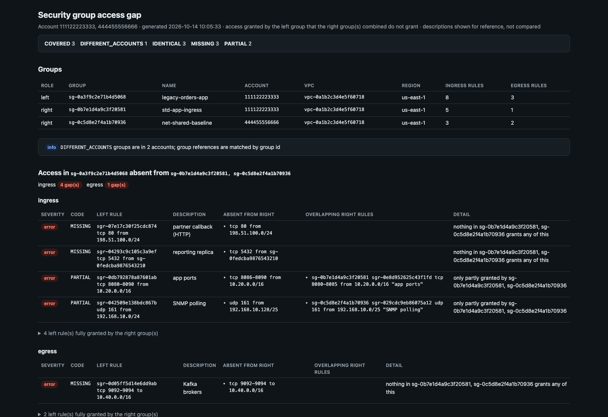

[← Index](../README.md)

# sg_access_gap

Finds access granted by a **left** security group that the **right** security
group(s) do not grant. With several right groups, the left group's access is
checked against their **combined** access, as if all of them were attached to
the same network interface. A range split across two right groups therefore
counts as granted.



> The screenshot is simulated: it's the real report rendered from the synthetic sample in
> [`docs/samples/sg_access_gap.py`](../docs/samples/sg_access_gap.py) (made-up account and resource IDs).

- Access the right groups grant beyond the left is not reported.
- Ingress and egress are checked separately.
- Descriptions are shown for reference but never compared.

## Usage

```bash
# LEFT RIGHT [RIGHT ...]
./sg_access_gap.py --profile prod-admin sg-0123456789abcdef0 sg-0fedcba9876543210
./sg_access_gap.py --profile prod-admin sg-0123456789abcdef0 sg-0fedcba9876543210 sg-0aaaabbbbccccdddd
./sg_access_gap.py --profile prod-admin \
    arn:aws:ec2:us-east-1:111122223333:security-group/sg-0123456789abcdef0 \
    arn:aws:ec2:us-east-1:111122223333:security-group/sg-0fedcba9876543210

# Across accounts: each account is read with its own local profile
./sg_access_gap.py \
    arn:aws:ec2:us-east-1:111122223333:security-group/sg-0123456789abcdef0 \
    arn:aws:ec2:us-east-1:444455556666:security-group/sg-0fedcba9876543210
```

Groups may be ARNs or ids, mixed. ARNs carry their own region. Bare ids use
`--region`, then `AWS_REGION`, then the profile's region.

### Accounts and profiles

Groups can be in several accounts when they are given as ARNs, and the left
group can be compared with right groups in other accounts. Profiles are
chosen the same way as in
[sg_rule_inventory](sg_rule_inventory.md#accounts-and-profiles):

1. `--profile`, if given, is used for its own account.
2. Every other account named by an ARN uses its local profile, found by account id. Profiles ending in `-priv` or `-cpar` are never chosen; `--account-profile ACCOUNT=PROFILE` forces one.
3. Bare ids belong to the `--profile` account. Without `--profile`, they belong to the ARNs' account when exactly one is named, otherwise (no ARNs) to `AWS_PROFILE`, then the default credentials.

Every profile is checked with `sts:GetCallerIdentity` before anything is
read. The run stops (exit 2) if:
- an account has no usable profile, or its profile is a different account;
- bare ids are mixed with ARNs from several accounts and there is no `--profile`;
- a group is not found in its account.

With several accounts, each group's account is shown, and a
`DIFFERENT_ACCOUNTS` info finding notes that group references are matched by
group id.

## How rules are compared

Each rule becomes a set of boxes: protocol × port range (or ICMP type/code) ×
address range. Prefix lists are expanded to their current entries. Each left
rule is then checked against every rule of every right group in the same
direction:

| Code | Severity | Meaning |
|---|---|---|
| `MISSING` | error | Nothing in the right groups overlaps this left rule |
| `PARTIAL` | error | The right groups grant only part of it |
| `PREFIX_LIST_UNRESOLVED` | warn | Prefix list entries couldn't be read; rules using it are compared by id only |
| `COVERED` | info | The right groups grant all of it through different rules (a prefix list vs. its CIDRs, a /16 vs. two /17s, a broader rule, or pieces from several right groups) |
| `IDENTICAL` | info | A right group has the same protocol, ports and peer |
| `DIFFERENT_VPCS` | info | Groups are in different VPCs, so group references may not be comparable |
| `DIFFERENT_ACCOUNTS` | info | Groups are in several accounts; group references are matched by group id |

- For `MISSING` and `PARTIAL`, `uncovered` is the exact absent access (merged CIDRs, ports, ICMP types).
- Every finding lists the overlapping right-group rules (group, rule id, rule, description).
- Security group references match by group id. A left self-reference matches a self-reference in any right group.
- IPv4 and IPv6 are compared separately.

Each direction gets a verdict: `N gap(s)`, `covered` or `identical`.

## Options

| Flag | Description |
|---|---|
| `SG ...` | Group ARNs or ids: `LEFT RIGHT [RIGHT ...]` |
| `--profile NAME` | AWS profile for its own account (and bare ids); see [Accounts and profiles](#accounts-and-profiles) |
| `--region REGION` | Region for bare group ids |
| `--account-profile ACCT=PROFILE` | Force the profile for an account (repeatable) |
| `--exclude-profile-suffix LIST` | Profile suffixes never chosen (default `-priv,-cpar`) |
| `--show-covered` | Also list left rules the right groups fully grant (`COVERED`, `IDENTICAL`) |

Plus the [common output flags](../README.md#reports).

## Output

- **Text**: per direction, each gap with its absent access and the overlapping right rules.
- **CSV / JSON**: every finding. The JSON also holds each group's full rule list with descriptions.
- **HTML**: finding counts, the groups, per-direction verdicts, and a gaps table per direction. Fully granted left rules are collapsed, and each group's full rule list with descriptions is at the end.

## IAM permissions

`sts:GetCallerIdentity`, `ec2:DescribeSecurityGroups`,
`ec2:DescribeSecurityGroupRules`, `ec2:DescribeManagedPrefixLists`,
`ec2:GetManagedPrefixListEntries`.
