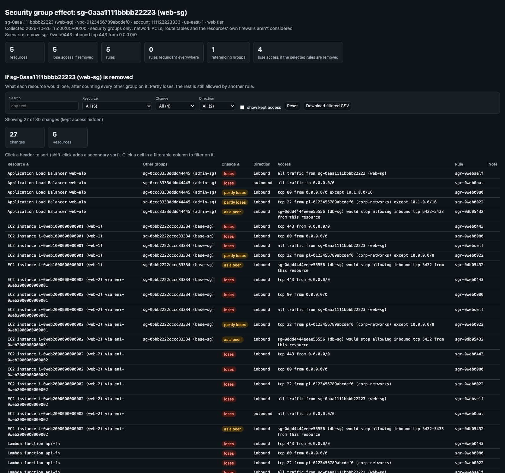

[← Index](../README.md)

# sg_effect

Shows what one security group really does on every resource that uses it, and what each resource would lose if
the group, or some of its rules, were removed. Every other security group on each resource is counted, so
access another group already allows isn't reported as lost.



> The screenshot is simulated: it's the real report rendered from the synthetic sample in
> [`docs/samples/sg_effect.py`](../docs/samples/sg_effect.py) (made-up account and resource IDs).

Give it a security group ID or ARN. It finds every resource that uses the group (EC2 instances, load balancers,
Lambda functions, RDS, VPC endpoints, ECS tasks, EFS and more) and works out:

- **If the group is removed:** what each resource would lose if the target group were taken off it. It counts
  the part of each rule that no other group allows, plus access that other groups grant to the target
  group's members.
- **If rules are removed** (`--remove-rule`, in the HTML report only): what each resource would lose if those
  rules of the target group were deleted, and for the access it keeps, which rule still allows it.
- **Redundant rules:** the rules of the target group that no resource needs, because other rules already
  allow their traffic everywhere. They can be deleted without changing any access.
- **Effective access** (`--full`, and in the HTML report): each resource's net inbound and outbound access,
  merged across all of its groups, with the group(s) and rule(s) that allow each entry.
- **Referencing groups** (`--full`, and in the HTML report): the security groups whose rules point at the
  target group, and the resources behind them.

The terminal shows only the removal effects and the redundant rules by default. `--full` adds the rest.

## Usage

```bash
# What each resource using the group would lose if the group were removed
./sg_effect.py --profile network-admin --region us-east-1 sg-0aaa1111bbbb22223
./sg_effect.py arn:aws:ec2:us-east-1:111122223333:security-group/sg-0aaa1111bbbb22223

# Also every rule, each resource's effective access, kept access and referencing groups
./sg_effect.py sg-0aaa1111bbbb22223 --full

# What would deleting these rules break? (sgr- IDs, or DIRECTION:PROTOCOL:PORTS:PEER; see the HTML report)
./sg_effect.py sg-0aaa1111bbbb22223 --remove-rule sgr-0web0443
./sg_effect.py sg-0aaa1111bbbb22223 --remove-rule in:tcp:22:pl-0123456789abcdef0 \
                                    --remove-rule out:-1:all:0.0.0.0/0

# One resource only (instance ID, load balancer or function name, or ENI ID)
./sg_effect.py sg-0aaa1111bbbb22223 --resource i-0web1000000000001

# Try scenarios offline against a saved JSON report
./sg_effect.py sg-0aaa1111bbbb22223 --json-out web-sg.json
./sg_effect.py --from-json web-sg.json --remove-rule sgr-0web0080 --html-out remove-0080.html
```

A rule spec is `DIRECTION:PROTOCOL:PORTS:PEER`:

| Part | Values |
|---|---|
| Direction | `in` / `out` (also `inbound`, `outbound`, `ingress`, `egress`) |
| Protocol | `tcp`, `udp`, `icmp`, `icmpv6`, `-1` or `all`, or a protocol number |
| Ports | `443`, `8000-8080`, or `all` (also for ICMP: `all` types, or the type number) |
| Peer | a CIDR, an `sg-` ID or a `pl-` ID |

It has to match a rule of the target group exactly. Use `--remove-rule` more than once to remove several rules
together.

The rule removal scenario appears only in the HTML report, as an "If the selected rules are removed" table and
a summary card. The terminal output, `--json`, and the saved CSV and JSON leave it out; the terminal output
ends with a line pointing to the report. `--remove-rule` with `--no-save` needs `--html-out`.

### Accounts and profiles

A group ARN is read through the local profile for its account (`--profile` is used if it's for that account).
A bare group ID is read with `--profile`, `AWS_PROFILE` or the default credentials, in `--region`,
`AWS_REGION` or the profile's region. See [Accounts and profiles](../README.md#accounts-and-profiles).

### Example

The target `web-sg` allows HTTPS and HTTP from anywhere, SSH from the `corp-networks` prefix list (10.0.0.0/8
and 192.168.0.0/16), all traffic between its own members, and all outbound. The instances also have `base-sg`,
which allows SSH and ICMP from 10.0.0.0/8 and all outbound. `db-sg` allows 5432-5433 from `web-sg`, and 5433
from `base-sg`.

```text
$ ./sg_effect.py sg-0aaa1111bbbb22223
sg-0aaa1111bbbb22223 (web-sg) · vpc-0123456789abcdef0 · account 111122223333 · us-east-1 · 5 rules · used by 5 resources

If sg-0aaa1111bbbb22223 (web-sg) is removed:

  Application Load Balancer web-alb   [also: sg-0ccc3333dddd44445 (admin-sg)]
    ~ inbound tcp 80 from 0.0.0.0/0 except 10.1.0.0/16
    ~ inbound tcp 22 from pl-0123456789abcdef0 (corp-networks) except 10.1.0.0/16
    - inbound all traffic from sg-0aaa1111bbbb22223 (web-sg)
    - outbound all traffic to 0.0.0.0/0
    - sg-0ddd4444eeee55556 (db-sg) would stop allowing inbound tcp 5432-5433 from this resource

  EC2 instance i-0web1000000000001 (web-1)   [also: sg-0bbb2222cccc33334 (base-sg)]
  EC2 instance i-0web2000000000002 (web-2) via eni-0web2000000000001   [also: sg-0bbb2222cccc33334 (base-sg)]
    - inbound tcp 443 from 0.0.0.0/0
    - inbound tcp 80 from 0.0.0.0/0
    ~ inbound tcp 22 from pl-0123456789abcdef0 (corp-networks) except 10.0.0.0/8
    - inbound all traffic from sg-0aaa1111bbbb22223 (web-sg)
    - sg-0ddd4444eeee55556 (db-sg) would stop allowing inbound tcp 5432 from this resource

  EC2 instance i-0web2000000000002 (web-2) via eni-0web2000000000002
  Lambda function api-fn
    - inbound tcp 443 from 0.0.0.0/0
    - inbound tcp 80 from 0.0.0.0/0
    - inbound tcp 22 from pl-0123456789abcdef0 (corp-networks)
    - inbound all traffic from sg-0aaa1111bbbb22223 (web-sg)
    - outbound all traffic to 0.0.0.0/0
    - sg-0ddd4444eeee55556 (db-sg) would stop allowing inbound tcp 5432-5433 from this resource

No rule of sg-0aaa1111bbbb22223 is redundant on every resource.

~ = partly lost (the rest is still allowed by another rule). --full shows each resource's effective access.
```

Resources that would lose the same access are listed together, with their other groups. `-` is lost
entirely, `~` partly: SSH from 10.0.0.0/8 survives on the instances through `base-sg`, so only
192.168.0.0/16 is lost. The database keeps accepting 5433 from them through `base-sg`, so only 5432 is lost.
An instance whose interfaces have different groups is listed once per interface ("via eni-…"); the second
interface of `web-2` has only `web-sg`, so like the Lambda function it would lose everything.

### Example: `--full`

`--full` lists each resource's effective access, marking with `*` what the target group allows:

```text
$ ./sg_effect.py sg-0aaa1111bbbb22223 --full
...
== EC2 instance i-0web1000000000001 (web-1)
   ENI eni-0web1000000000001  10.0.1.11  subnet-0a1b2c3d4e5f60718
   Groups: sg-0aaa1111bbbb22223 (web-sg) [target], sg-0bbb2222cccc33334 (base-sg)
   Inbound (6):
   * tcp 443 from 0.0.0.0/0                            sg-0aaa1111bbbb22223
   * tcp 80 from 0.0.0.0/0                             sg-0aaa1111bbbb22223
   * all traffic from sg-0aaa1111bbbb22223 (web-sg)    sg-0aaa1111bbbb22223
   * tcp 22 from pl-0123456789abcdef0 (corp-networks)  sg-0aaa1111bbbb22223
     icmp all types from 10.0.0.0/8                    sg-0bbb2222cccc33334
     tcp 22 from 10.0.0.0/8                            sg-0bbb2222cccc33334   (covered by inbound tcp 22 from pl-0123456789abcdef0 (corp-networks))
   Outbound (1):
   * all traffic to 0.0.0.0/0  sg-0aaa1111bbbb22223, sg-0bbb2222cccc33334
   If sg-0aaa1111bbbb22223 is removed from it:
     loses inbound tcp 443 from 0.0.0.0/0   [sgr-0web0443]
     loses inbound tcp 80 from 0.0.0.0/0   [sgr-0web0080]
     partly loses inbound tcp 22 from pl-0123456789abcdef0 (corp-networks) except 10.0.0.0/8   [sgr-0web0022]
     loses inbound all traffic from sg-0aaa1111bbbb22223 (web-sg)   [sgr-0webself]
     keeps outbound all traffic to 0.0.0.0/0   (still allowed by outbound all traffic to 0.0.0.0/0 [sg-0bbb2222cccc33334 (base-sg)])
     sg-0ddd4444eeee55556 (db-sg) would stop allowing inbound tcp 5432 from this resource
```

The end of the `--full` output summarizes each rule of the target group, and lists the groups that reference it:

```text
Target rules across 5 resources:
    sgr-0web0443  inbound tcp 443 from 0.0.0.0/0: only rule allowing it on 4, redundant on 1
    sgr-0web0080  inbound tcp 80 from 0.0.0.0/0: only rule allowing it on 5
    sgr-0web0022  inbound tcp 22 from pl-0123456789abcdef0 (corp-networks): only rule allowing it on 5
    sgr-0webself  inbound all traffic from sg-0aaa1111bbbb22223 (web-sg): only rule allowing it on 5
    sgr-0web0out  outbound all traffic to 0.0.0.0/0: only rule allowing it on 3, redundant on 2

Groups whose rules reference sg-0aaa1111bbbb22223:
    sg-0ddd4444eeee55556 (db-sg), used by 1 other resource:
      inbound tcp 5432-5433 from sg-0aaa1111bbbb22223 (web-sg)
```

## How it works

Security groups only allow traffic, so a resource's access in each direction is the union of every rule in
every group on its network interface. To find what removing something costs, each rule is treated as a block
of traffic:

- **Protocol:** `tcp`, `udp`, `icmp`, `icmpv6`, or another protocol by number. "All traffic" is all of them.
- **Ports:** a port range for TCP/UDP, a type range for ICMP.
- **Peers:** CIDR ranges. Prefix lists are expanded to their entries, so a `/8` in another group covers the
  matching part of a prefix list. A referenced security group is its own peer: it's covered only by a rule
  that references the same group.

The tool subtracts every rule that stays from every rule that goes. What's left is exactly the traffic that
would be lost, down to individual ports and address ranges. "Several rules together" means no single rule
covers the access, but the remaining rules do between them.

For a group that references the target (as in `db-sg` above), removing the target from a resource means
those rules stop matching it. The tool counts that loss unless the referencing group has a rule for another
of the resource's groups that covers the same traffic.

Resources are found through their network interfaces (`DescribeNetworkInterfaces` filtered by group). The
interface's attachment, type and description identify the owner. Interfaces of the same resource are grouped
together. If an instance has interfaces with different groups, each set is shown separately, because access
is per interface.

### What isn't considered

- Network ACLs, route tables and firewalls on the resource itself. The result is what security groups allow,
  not whether a path exists. Use [`reachability_trace`](../../reachability_trace/) for the path.
- The IP addresses behind a referenced group. A CIDR rule doesn't count as covering a group reference, even if
  the group's members sit inside the CIDR.
- A prefix list whose entries can't be read. It's treated as an opaque peer, with a warning.
- A referenced group in a peered VPC or another account that can't be read. It's shown by ID, with a
  warning.
- Hyperplane ENIs shared by several Lambda functions are labeled with the function in the ENI description.

## Options

| Flag | Description |
|---|---|
| `SG` | Group ID or ARN (not needed with `--from-json`) |
| `--profile NAME` | AWS profile for a bare group ID; see [Accounts and profiles](#accounts-and-profiles) |
| `--region REGION` | Region for a bare group ID |
| `--account-profile ACCT=PROFILE` | Force the profile for an account (repeatable) |
| `--exclude-profile-suffix LIST` | Profile suffixes never chosen (default `-priv,-cpar`) |
| `--full` | Also list every rule, each resource's effective access, kept access and referencing groups |
| `--remove-rule RULE` | Rule removal scenario, in the HTML report only (repeatable) |
| `--resource ID` | Only this resource: instance ID, load balancer or function name, or ENI ID (repeatable) |
| `--from-json PATH` | Re-analyze a saved sg_effect JSON report, offline |

Plus the [common output flags](../README.md#reports).

## Output

- **Text**: what each resource would lose if the group were removed (resources with the same losses are
  listed together), and the rules that are redundant everywhere. With `--full`, every rule, each resource's
  effective access, kept access, the rule summary and the referencing groups.
- **CSV**: one row per change to a resource if the group were removed: resource, its other groups, change
  (`loses`, `partly loses`, `as a peer`, `keeps`, `no change`), direction, access, rule and note.
- **JSON**: the analysis, plus the collected data under `bundle`, which `--from-json` reads back.
- **HTML**: summary cards, then filterable tables: the changes if the group is removed (kept access hidden until
  ticked), the changes if the selected rules are removed, the target's rules and where each is the only rule
  allowing its traffic, every resource's effective access, the referencing groups, and any warnings.

Exit codes: `0` ok, `1` the `--remove-rule` scenario takes access away from at least one resource (so a script
can check that a clean-up is safe), `2` fatal error.

## IAM permissions

`sts:GetCallerIdentity`, `ec2:DescribeSecurityGroups`, `ec2:DescribeSecurityGroupRules`,
`ec2:DescribeNetworkInterfaces`, `ec2:DescribeManagedPrefixLists`, `ec2:GetManagedPrefixListEntries`,
`ec2:DescribeInstances`.
