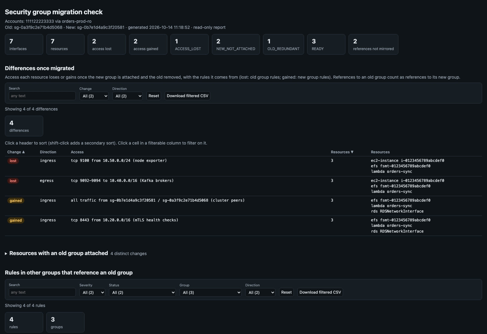

[← Index](../README.md)

# sg_migration_check

Checks a security group migration before the old group is removed:
- where the old group is attached;
- whether the new group is attached there too;
- exactly what access each resource would lose, or gain, when the old group is removed.



> The screenshot is simulated: it's the real report rendered from the synthetic sample in
> [`docs/samples/sg_migration_check.py`](../docs/samples/sg_migration_check.py) (made-up account and resource IDs).

It also lists rules in other groups that reference the old group and are
not mirrored for the new one.

Read-only: only Describe and Get calls are made.

## Usage

```bash
# One old group replaced by one new group (bare ids need a region)
./sg_migration_check.py --region us-east-1 --old sg-0123456789abcdef0 --new sg-0fedcba9876543210

# By ARN (the profile is found from the account), listing every access change
./sg_migration_check.py \
    --old arn:aws:ec2:us-east-1:111122223333:security-group/sg-0123456789abcdef0 \
    --new arn:aws:ec2:us-east-1:111122223333:security-group/sg-0fedcba9876543210 --show-changes

# Several old groups consolidated into one new group
./sg_migration_check.py --region us-east-1 --old sg-0aaaa... sg-0bbbb... --new sg-0cccc...
```

Groups are ids or ARNs. Accounts and profiles work as in
[sg_rule_inventory](sg_rule_inventory.md#accounts-and-profiles):
- each account named by an ARN is read with its own local profile (never `-priv` / `-cpar`);
- `--profile` is used for its own account and for bare ids.

## What it checks

1. **Resources.** Every network interface the old group is attached to. Each is labelled with what it belongs to, best effort from the interface's attachment, type and description:

   | Type | Label |
   |---|---|
   | `ec2-instance` | instance id |
   | `lambda` | function name |
   | `load-balancer` | load balancer name |
   | `rds` | interface description |
   | `vpc-endpoint` | endpoint id |
   | `efs` | mount target description |
   | `managed (...)` | requester-managed interface of another service |

   Requester-managed interfaces (Lambda, load balancers, RDS …) are changed through their service, which the detail notes.

2. **Access per resource.** Access is computed exactly from the rules of the groups attached: protocol × ports × addresses, with prefix lists expanded. Equivalent rules written differently are not differences. For each resource:
   - **Lost if old removed**: access the resource loses when the old group is removed from the groups attached today, with the old group's rules responsible;
   - **If new attached**: when a new group is not attached yet, the projected change if it were attached and the old group removed, as access lost and access gained.

   Broad changes are summarized. A changed range wider than a /16 (IPv6: /48) that isn't a single CIDR is named by the smallest block that holds it. For example, removing `10.0.0.0/8` when other groups still allow `10.1.2.0/24` reads `tcp 443 from part of 10.0.0.0/8`, not a list of every remaining piece. A range that is exactly one CIDR is shown as it is, however large. Smaller ranges are listed in full.

3. **References.** Rules in other groups, in the same account and region, that reference the old group (for example `tcp 5432 from sg-old`). A rule is mirrored when the same group has the same rule (direction, protocol, ports) referencing the new group. If it is not, resources moved to the new group lose that access.

**Equated references.** References to an old group are treated as references to its new group:
- the groups are paired by position when as many new as old groups are given;
- with a single new group, every old group pairs with it.

So the old group's "from self" becoming the new group's "from self" is not a change. Such a reference is shown as `sg-new / sg-old`. `--no-equate-references` turns this off.

## Grouping identical changes

Resources whose change is identical are listed together, once: same status,
same missing new groups, same access lost and gained, and the same rules
responsible. For example, every instance in an Auto Scaling group carrying
the same groups appears as one row (`G1: 12 resources`) with its resources
listed, instead of twelve repeated rows. The text and HTML reports show
these groups. The CSV and JSON keep one row per resource, with the group id
in `change_group`; the JSON also has `change_groups`.

## Statuses

| Status | Severity | Meaning |
|---|---|---|
| `READY` | info | New group attached; removing the old group loses nothing |
| `ACCESS_LOST` | error | New group attached, but removing the old group loses access (listed) |
| `NEW_NOT_ATTACHED` | error | New group not attached; removing the old group now loses access. The projected change with the new group attached is listed |
| `OLD_REDUNDANT` | warn | New group not attached, but removing the old group loses nothing: other attached groups already grant its access |
| `NEW_IN_OTHER_VPC` | error | A new group is in another VPC than the resource, so it cannot be attached there |
| `REFERENCE_MIRRORED` | info | A rule referencing the old group has a matching rule referencing the new group |
| `REFERENCE_NOT_MIRRORED` | warn | A rule referencing the old group has no matching rule for the new group |

## Options

| Flag | Description |
|---|---|
| `--old SG …` | Old group ids / ARNs to be removed (repeatable) |
| `--new SG …` | New group ids / ARNs replacing them (repeatable) |
| `--profile NAME` | Profile for its own account and for bare ids |
| `--region REGION` | Region for bare ids |
| `--account-profile ACCT=PROFILE` | Force the profile for an account (repeatable) |
| `--exclude-profile-suffix LIST` | Profile suffixes never chosen (default `-priv,-cpar`) |
| `--no-equate-references` | Do not treat references to an old group as references to its new group |
| `--show-changes` | Text report: list the access lost / gained per resource and the rules responsible |

Plus the common output flags, described under [Reports](../README.md#reports).

## Output

- **Text**:
  - accounts, old and new groups, and how references are equated;
  - one entry per group of resources with identical changes: status, number of resources, and how many access changes; then each resource (type, label, interface, VPC, requester for managed interfaces);
  - rules referencing the old group that are not mirrored;
  - with `--show-changes`, every access change and the rules responsible.
- **CSV**: one row per resource (interface), with its `change_group`. List cells are `; `-separated.
- **JSON**: `{generated, accounts, old, new, rename, groups, warnings, resources, change_groups, references}`.
- **HTML**:
  - one row per group of identical changes, with its resources, filterable by severity, status, type, account, VPC and missing new group, plus a summary by status;
  - the references.
  - Full window width.

Reports are saved under `reports/sg_migration_check/YYYY-MM-DD/`.

Exit codes:
- `0`: every resource is `READY` and every reference is mirrored (or the old group is attached nowhere);
- `1`: anything else to review;
- `2`: fatal (bad arguments, no usable profile, AWS error).

## Limits

- References are searched in the old group's own account and region. References from peered VPCs in other accounts are not searched.
- Resources are found through their network interfaces. Anything that names a security group without an interface is not covered: launch templates, Auto Scaling groups, ECS service definitions, Lambda configurations with no interface yet.

## IAM permissions

- `sts:GetCallerIdentity`
- `ec2:DescribeNetworkInterfaces`
- `ec2:DescribeSecurityGroups`
- `ec2:DescribeSecurityGroupRules`
- `ec2:DescribeManagedPrefixLists`
- `ec2:GetManagedPrefixListEntries`
