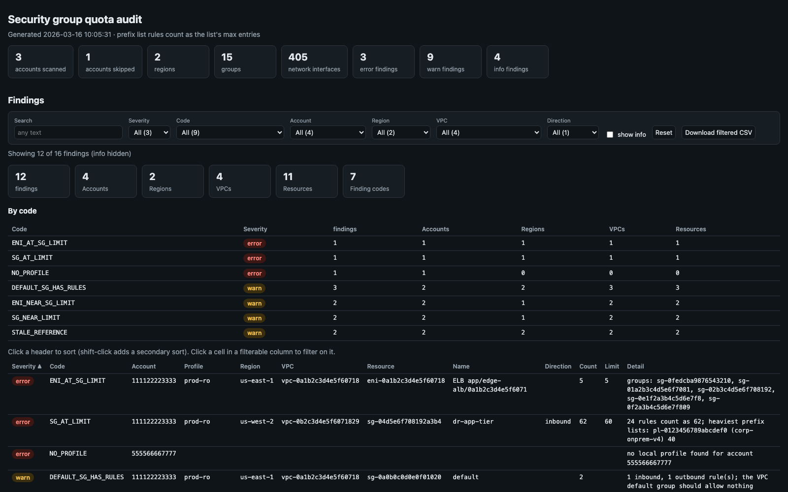

[← Index](../README.md)

# sg_quota_audit

Finds security groups and network interfaces at or near AWS quotas, across
accounts and regions, before a change fails. It also lists clean-up
candidates: unattached groups, stale references, and VPC default groups that
allow traffic. It is the security group counterpart of
[`fmm_nacl_audit`](fmm_nacl_audit.md)'s NACL limit check.



> The screenshot is simulated: it's the real report rendered from the synthetic sample in
> [`docs/samples/sg_quota_audit.py`](../docs/samples/sg_quota_audit.py) (made-up account and resource IDs).

Prefix lists are the usual surprise. A rule that references a managed prefix
list counts against the rules-per-group quota as the list's **maximum
entries**, not as one rule. A group with 11 rules can therefore be full.

## Usage

```bash
# One account (the profile's), one region
./sg_quota_audit.py --profile prod-admin --region us-east-1

# Every account with a local profile, every region
./sg_quota_audit.py --all-accounts --all-regions

# Selected accounts and one VPC, with a wider warning margin
./sg_quota_audit.py --account 111122223333,444455556666 --vpc vpc-0abc --headroom 10

# Use known quota values instead of looking them up
./sg_quota_audit.py --rule-limit 100 --sg-per-eni-limit 10
```

## How it works

For each account (through its verified local profile, see
[Accounts and profiles](fmm_nacl_audit.md#accounts-and-profiles)) and region:

1. **Quotas.** Looked up with Service Quotas:

   | Quota | Code | Default |
   |---|---|---|
   | Inbound or outbound rules per security group | `vpc` / `L-0EA8095F` | 60 |
   | Security groups per network interface | `vpc` / `L-2AFB9258` | 5 |

   The lookup order is the applied value, then the AWS default value, then
   the default above. `--rule-limit` / `--sg-per-eni-limit` skip the lookup.
   The source of each value is shown in the report.
2. **Rule usage.** Each group's rules are counted per direction:
   - a CIDR rule or a group-reference rule counts as 1;
   - a prefix list rule counts as the list's `MaxEntries`;
   - an AWS-managed prefix list without a `MaxEntries` value, or a list that
     can't be read, counts as 1, and the finding says so.

   Both the raw rule count and this effective count are reported.
3. **Groups per network interface.** Counted from `DescribeNetworkInterfaces`.
4. **Hygiene.**
   - Stale references, from `DescribeStaleSecurityGroups` per VPC.
   - Groups attached to no network interface (noting whether other groups
     still reference them).
   - VPC default groups that hold any rule.

## Options

| Flag | Description |
|---|---|
| `--profile NAME` | Scan this profile's account (default `AWS_PROFILE`) unless `--account` / `--all-accounts` is given |
| `--account ID` | Account(s) to scan through their local profiles; repeatable / comma-separated |
| `--all-accounts` | Every account with a usable local profile |
| `--account-profile ACCT=PROFILE` | Force the profile for an account (repeatable) |
| `--exclude-profile-suffix LIST` | Profile suffixes never used (default `-priv,-cpar`) |
| `--region REGION` / `--all-regions` | Region(s) to scan (default `AWS_REGION` or `us-east-1`) |
| `--vpc VPC_ID` | Only these VPC(s); repeatable |
| `--rule-limit N` | Rules-per-group quota to use instead of looking it up (env `SG_RULE_LIMIT`) |
| `--sg-per-eni-limit N` | Groups-per-interface quota to use instead of looking it up (env `SG_PER_ENI_LIMIT`) |
| `--headroom N` | Flag groups within N rules of the limit (default 5, env `SG_RULE_HEADROOM`) |
| `--eni-headroom N` | Flag network interfaces within N groups of the limit (default 1, env `SG_ENI_HEADROOM`) |
| `--show-info` | Show info findings in the text report |

Common output flags: see [Reports](../README.md#reports).

## Findings

| Code | Severity | Meaning |
|---|---|---|
| `SG_AT_LIMIT` | error | A direction's effective rule count is at the rules-per-group limit; detail lists the heaviest prefix lists |
| `SG_NEAR_LIMIT` | warn | Within `--headroom` of the limit |
| `ENI_AT_SG_LIMIT` | error | A network interface carries the maximum number of groups |
| `ENI_NEAR_SG_LIMIT` | warn | Within `--eni-headroom` of that maximum |
| `STALE_REFERENCE` | warn | A rule references a group that no longer exists, or one across a deleted peering connection |
| `DEFAULT_SG_HAS_RULES` | warn | A VPC default group holds a rule (it should allow nothing) |
| `NO_PROFILE`, `PROFILE_ACCOUNT_MISMATCH`, `ACCOUNT_ERROR` | error | The account (or one of its regions) could not be scanned |
| `UNATTACHED_SG` | info | A non-default group is attached to no network interface; detail says whether other groups reference it |
| `QUOTA_DEFAULTS_USED` | info | Service Quotas couldn't be read, so default values were used |

`count` and `limit` on each finding give the usage and the quota it was
compared with.

## Output

- **Text**:
  - the run totals and the quota values (with their source) per account and region;
  - findings grouped by account and region;
  - info findings only with `--show-info`.
- **CSV**: every finding.
- **JSON**: `{stats, quotas, groups, findings}`, where `groups` holds every
  scanned group's raw and effective counts per direction, its attached
  network interfaces, the groups that reference it, and the weight used by
  each prefix list.
- **HTML**: two interactive tables.
  - *Findings*: filters for severity, code, account, region, VPC and
    direction; unique counts of accounts, regions, VPCs and resources; a
    per-code summary. Info findings are hidden until ticked.
  - *Security group usage*: every scanned group, sorted by peak usage (the
    fuller direction as a percentage of the limit). It can be sorted by any
    column and filtered by account, region and VPC.

Exit codes: `0` nothing found, `1` error or warning findings, `2` fatal error.

## IAM permissions

Per scanned account:

- `sts:GetCallerIdentity`
- `ec2:DescribeSecurityGroups`, `ec2:DescribeSecurityGroupRules`
- `ec2:DescribeManagedPrefixLists`
- `ec2:DescribeNetworkInterfaces`, `ec2:DescribeStaleSecurityGroups`
- `servicequotas:GetServiceQuota`, `servicequotas:GetAWSDefaultServiceQuota`
  (optional; defaults are used without them)
- `ec2:DescribeRegions` (for `--all-regions`)
