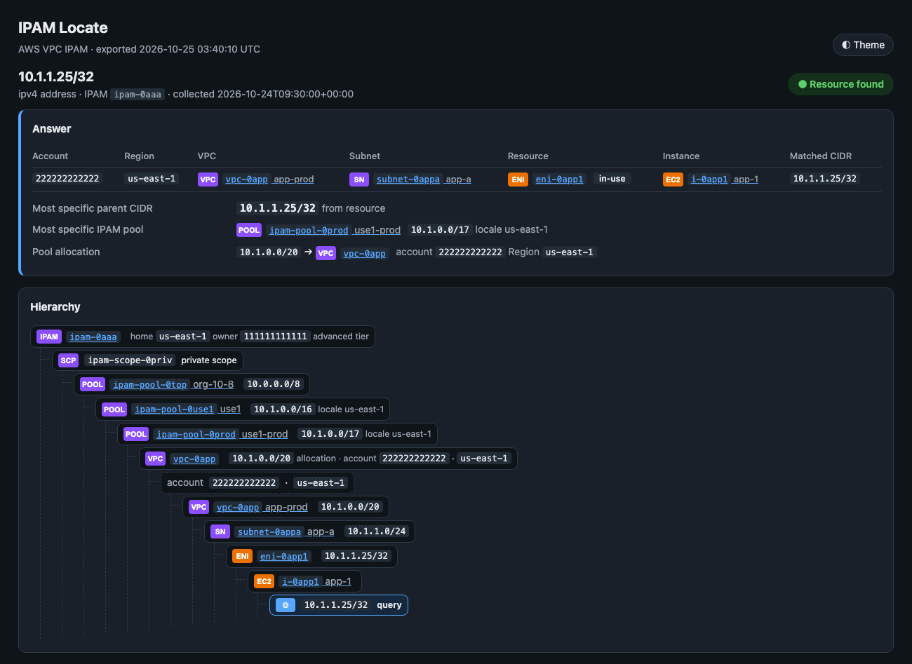
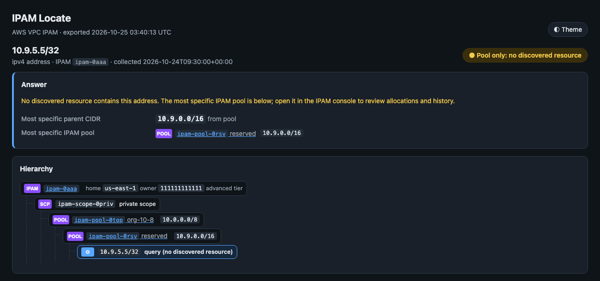
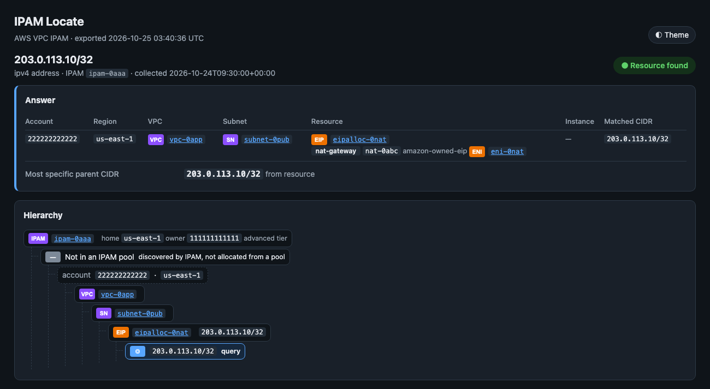
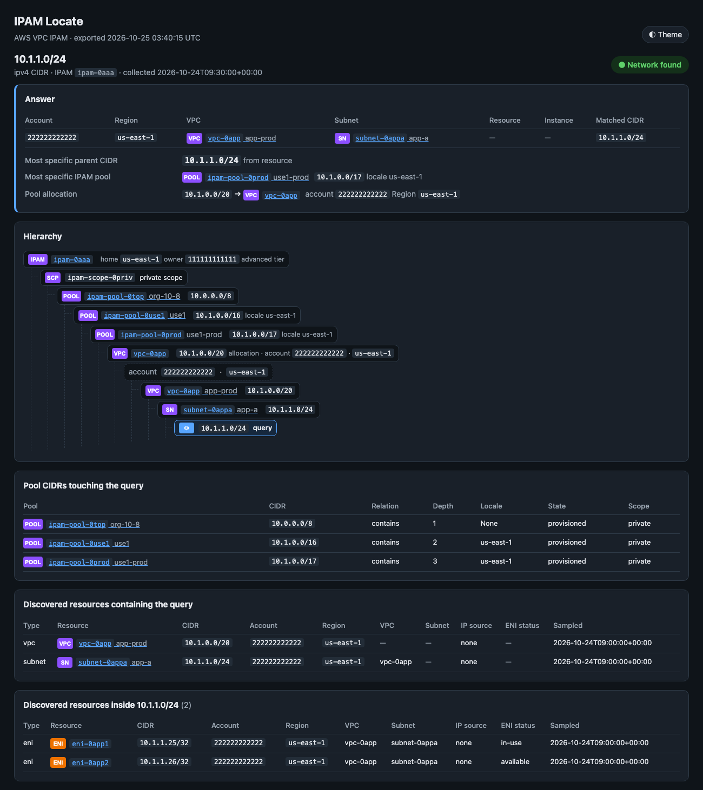
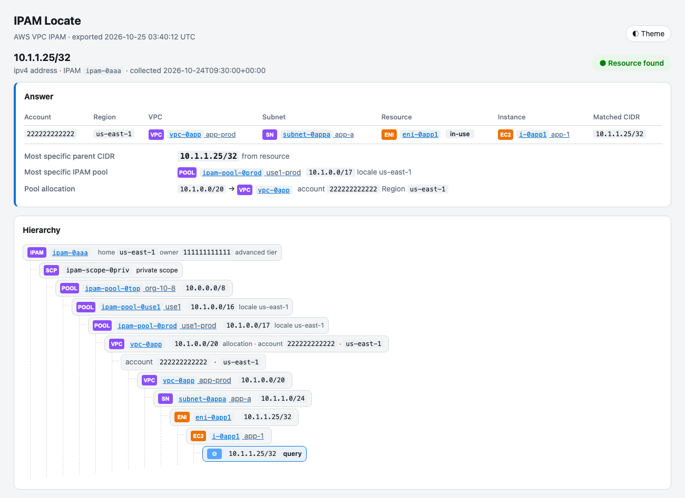

# IPAM Locate

Finds the account, Region, VPC, subnet and resource behind an IP address or CIDR using Amazon VPC
IP Address Manager (IPAM). It reads the IPAM's pools, pool CIDRs and allocations, discovered resource CIDRs,
public addresses and address history from the IPAM home Region. Then it narrows the query to its owner(s):
account → Region → VPC → subnet → ENI / EIP / service → instance.

When no discovered resource contains the address, the tool reports the most specific parent CIDR and the
IPAM pool it belongs to, with a console link for manual review. Each query produces a self-contained HTML
report with the full hierarchy, from the IPAM through scope, pools, allocation, VPC, subnet and resource,
down to the query.

It is a companion to [`reachability_trace`](../reachability_trace/): locate an unknown address first, then
trace a path to it.



> The screenshots are simulated. They are reports rendered from the synthetic fixtures in `tests/fixtures/`
> (made-up account IDs and resource IDs).

## Usage

The tool is read-only: it never changes IPAM or EC2 resources, so there is no dry-run or `--execute` mode.
Run it with credentials for the IPAM owner, or the IPAM delegated administrator account, in the IPAM home
Region.

```bash
# Locate an address: prints a summary and writes reports/<date>/<account>/ipam-locate_10.1.1.25_32.html
python ipam_locate.py 10.1.1.25 --profile network-admin --region us-east-1

# Several queries, IPv6, or a CIDR
python ipam_locate.py 10.1.1.25 203.0.113.10 2001:db8::5 10.1.1.0/24

# One combined report, and save the raw data for later
python ipam_locate.py 10.1.1.25 10.9.5.5 -o lookups.html --json-out lookups.json

# Re-render saved data offline (no AWS calls)
python ipam_locate.py --from-json lookups.json -o lookups.html

# Only search some operating Regions (faster on large estates)
python ipam_locate.py 10.2.1.5 --regions eu-west-1,eu-central-1

# Summary only, or the raw bundle as JSON
python ipam_locate.py 10.1.1.25 --no-report
python ipam_locate.py 10.1.1.25 --json --no-report
```

Example summary:

```text
Query  10.1.1.25/32  (ipv4, address)
IPAM   ipam-0aaa  home us-east-1  owner 111111111111  advanced tier
Result resource found
  1. account 222222222222 · us-east-1 · vpc-0app · subnet-0appa · eni-0app1 · i-0app1  [10.1.1.25/32]
Most specific parent  10.1.1.25/32  (from resource)
Most specific pool    ipam-pool-0prod  10.1.0.0/17  https://us-east-1.console.aws.amazon.com/ipam/home?region=us-east-1#PoolDetails:poolId=ipam-pool-0prod
Pool allocation       10.1.0.0/20 -> vpc vpc-0app account 222222222222 us-east-1
```

### Options

| Flag | Description |
|---|---|
| `IP_OR_CIDR ...` | IPv4/IPv6 address or CIDR. Host bits must be zero (`10.1.2.3/16` is rejected rather than widened) |
| `--profile NAME` | AWS profile (overrides `AWS_PROFILE`). Never included in reports or JSON |
| `--region REGION` | IPAM home Region (default `IPAM_REGION`, then `AWS_REGION`, then `AWS_DEFAULT_REGION`) |
| `--ipam-id ID` | IPAM to use when the home Region has more than one (default `IPAM_ID`) |
| `--regions R1,R2` | Only search these operating Regions for discovered resources |
| `-o/--output FILE.html` | Write one combined report instead of one report per query |
| `--reports-dir DIR` | Reports root (default `IPAM_REPORTS_DIR` or `./reports`) |
| `--no-report` | Print the summary only |
| `--theme dark\|light\|auto` | Report theme (default `IPAM_THEME` or `dark`). Each report also has an in-page toggle |
| `--title TEXT` | Page title (default "IPAM Locate") |
| `--json` | Print the bundle(s) as JSON instead of the summary |
| `--json-out FILE.json` | Also save the bundle(s) for `--from-json` |
| `--from-json FILE.json` | Re-render saved bundles offline (repeatable) |
| `-v` / `-q` | Debug / warnings-only logging |

## How it narrows a query

1. **IPAM:** finds the IPAM in `--region`, its scopes, and the resource discoveries associated with it,
   including discoveries shared from other accounts, along with their operating Regions.
2. **Pools:** gets the CIDRs of every pool in the query's address family (IPv4 or IPv6). For pools whose
   CIDRs touch the query, it also gets their allocations. Pools are chained through their source pool,
   from the top-level pool down to the most specific one.
3. **Discovered resources:** in each operating Region, `GetIpamDiscoveredResourceCidrs` lists VPCs, subnets,
   ENIs, EIPs and public IPv4/IPv6 pools. It keeps the records whose CIDR contains the query, or that sit
   inside it for CIDR queries. These calls run in parallel.
4. **Public addresses:** unless the query is in a range that's never public (RFC 1918, CGNAT, link-local,
   loopback or ULA), `GetIpamDiscoveredPublicAddresses` adds the ENI, instance and AWS service behind a
   public IP, such as a NAT gateway or load balancer.
5. **Instance:** for a single address, `GetIpamAddressHistory` returns the current records for that exact
   IP, which name the instance that owns the ENI.
6. **Answer:** results are grouped by (account, Region, VPC). The most specific record in each group is
   its leaf. Groups are ranked by leaf type (instance, service, ENI/EIP, subnet, VPC), then by prefix length.

IPAM doesn't document filter names for these calls, so every list is fetched in full (paginated) and
matched locally. Large estates take longer. Use `--regions` to limit the search.

### Results

| Badge | Meaning |
|---|---|
| **Resource found** | An instance, service, ENI, EIP or public IP contains the query |
| **Network found** | A subnet or VPC contains the query, but no specific resource does (for example, an unassigned address) |
| **Pool only** | No discovered resource contains it. The report shows the most specific parent CIDR and IPAM pool, with a console link |
| **Not found** | Nothing in this IPAM contains it. Check the scope, the operating Regions, or another IPAM |

Private ranges are often reused, so one address can match several owners. All of them are listed, the
most specific first, and the badge shows the count.

## HTML report

Each report is a single HTML file with inline CSS and SVG and no external resources. Dark is the default;
use `--theme light|auto` or the in-page toggle. Printing always uses the light theme.

- **Answer:** one row per owner (account, Region, VPC, subnet, resource, instance, matched CIDR), followed by
  the most specific parent CIDR, the most specific IPAM pool, and the pool allocation.
- **Hierarchy:** a tree running IPAM → scope → pools → allocation → account/Region → VPC → subnet →
  ENI/EIP → instance → query. Resources that are discovered but not allocated from a pool appear under
  *Not in an IPAM pool*.
- **Details:**
  - Tables of pool CIDRs touching the query, discovered resources containing it, resources inside a CIDR
    query, public addresses, and current address history.
  - Search coverage (which discoveries and Regions were searched) and any warnings.
  - The raw API data as JSON.



A public IP behind a NAT gateway:



A CIDR query also lists the discovered resources inside it:



Light theme:



### Console links

IDs in the report link to the AWS console: VPCs, subnets, ENIs, instances and EIPs in that resource's
Region, and IPAM pools in the IPAM home Region. A link opens in whichever account your browser session is
signed in to, so a resource in another account needs a session in that account. The IPAM deep-link
formats (`#PoolDetails:poolId=…`, `#IpamDetails:ipamId=…`) follow the console's URL pattern but aren't
documented by AWS. If one doesn't open the right page, use the ID shown next to it.

### Reports folder

Without `-o`, reports go to `<reports-dir>/<YYYY-MM-DD>/<account-id>/ipam-locate_<query>.html`. The date
is when the data was collected (UTC). The account is the owner when exactly one owning account was found;
otherwise it's the IPAM owner account. `reports/` is git-ignored.

## Requirements

- Python 3.11+
- An IPAM, and credentials for its owner or delegated administrator account. Organization-wide discovery
  needs IPAM integrated with AWS Organizations, or resource discoveries shared and associated with the IPAM.
- Instance names come from `GetIpamAddressHistory`. If that call is denied or unavailable, the tool still
  narrows to the ENI and adds a warning.

## Installation

```bash
pip install -r requirements.txt
```

## Configuration

Copy `.env.example` to `.env` and fill in values (CLI flags override them):

| Variable | Default | Description |
|---|---|---|
| `AWS_PROFILE` | (default chain) | AWS profile name (never written to reports) |
| `IPAM_REGION` | `AWS_REGION` / `AWS_DEFAULT_REGION` | IPAM home Region |
| `IPAM_ID` | — | IPAM to use when the home Region has several |
| `IPAM_REPORTS_DIR` | `reports` | Reports root |
| `IPAM_THEME` | `dark` | Default report theme (`dark`, `light`, `auto`) |

## IAM Permissions

All read-only:

```json
{
  "Version": "2012-10-17",
  "Statement": [
    {
      "Effect": "Allow",
      "Action": [
        "ec2:DescribeIpams",
        "ec2:DescribeIpamScopes",
        "ec2:DescribeIpamPools",
        "ec2:DescribeIpamResourceDiscoveries",
        "ec2:DescribeIpamResourceDiscoveryAssociations",
        "ec2:GetIpamPoolCidrs",
        "ec2:GetIpamPoolAllocations",
        "ec2:GetIpamDiscoveredResourceCidrs",
        "ec2:GetIpamDiscoveredPublicAddresses",
        "ec2:GetIpamAddressHistory"
      ],
      "Resource": "*"
    }
  ]
}
```

## Output

- **Summary (stdout):** the query, the IPAM, the result, one line per owner, the most specific parent CIDR,
  the pool (with its console link) and the allocation.
- **JSON:** `--json` prints the bundle to stdout. `--json-out` saves it.
- **Logs (stderr):** `%(asctime)s %(levelname)s ipam_locate — message`. API failures for one Region, pool
  or scope are logged as warnings and listed in the report; the rest of the search continues.
- **Exit codes:** 0 on success, including when nothing was found. 1 for a bad query, a missing or ambiguous
  IPAM, credential problems, or a fatal AWS error.

## Tests

```bash
pip install -r requirements-dev.txt
python -m pytest tests
```

The tests use an in-memory fake of the IPAM API (`tests/fake_ipam.py`) with a synthetic organization. No
AWS credentials are needed.

## Regenerating screenshots

```bash
python docs/make_screenshots.py            # all
python docs/make_screenshots.py pool-only  # one
```

This needs macOS and Google Chrome. It renders the fixtures in `tests/fixtures/` and captures them with
headless Chrome.

## Platform Notes

- **macOS:** the system PKI truststore is used automatically through Security.framework (`truststore`).
- **Windows:** the Windows Certificate Store is used automatically. Credentials are at
  `%USERPROFILE%\.aws\credentials`.
- **Linux:** the system CA bundle is used through `truststore`. Make sure `ca-certificates` is installed.
