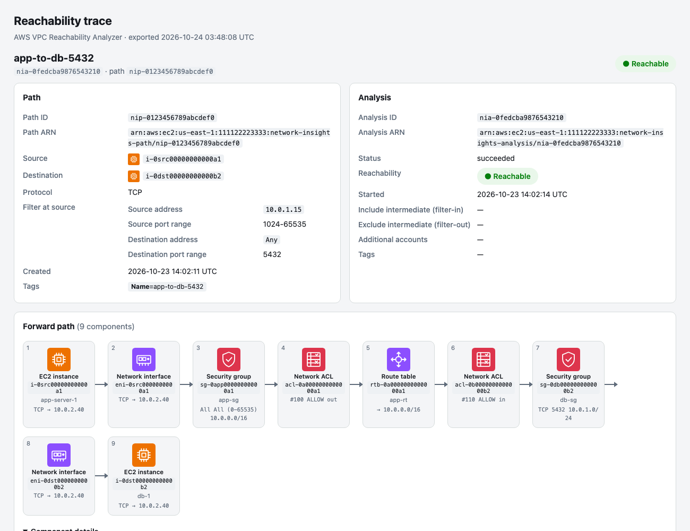
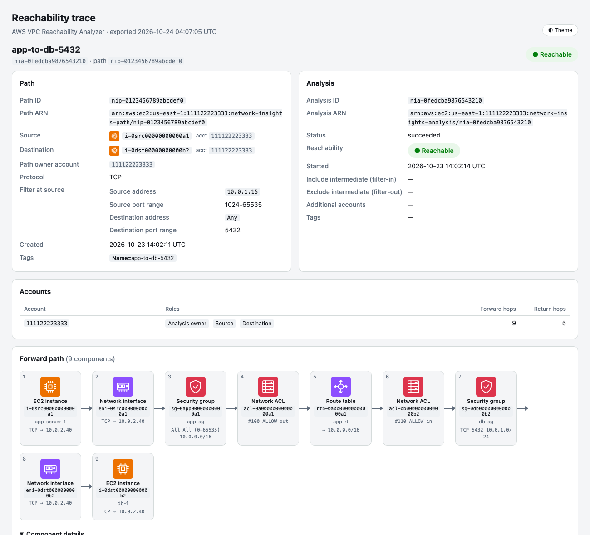
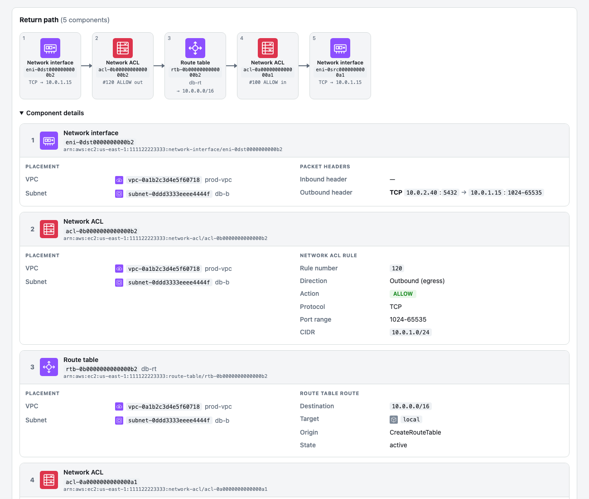
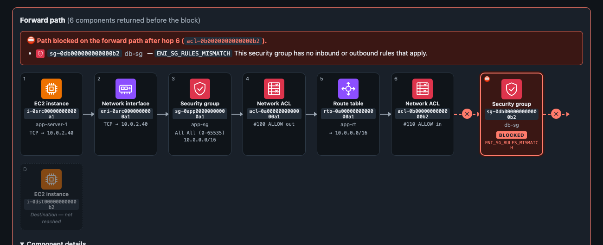
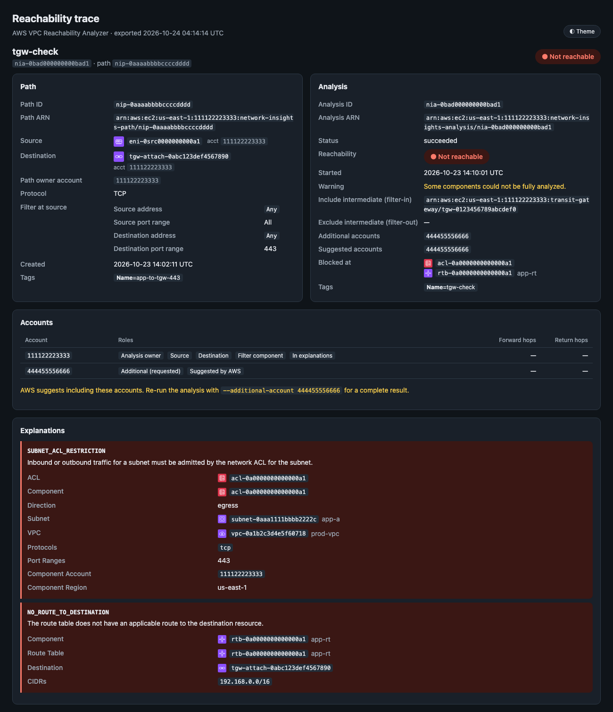
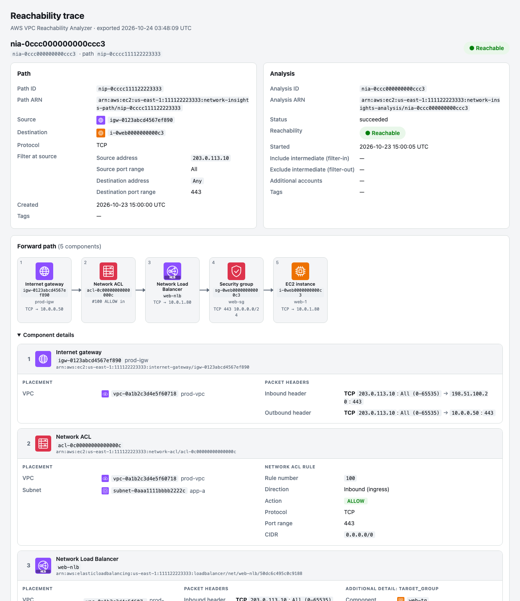
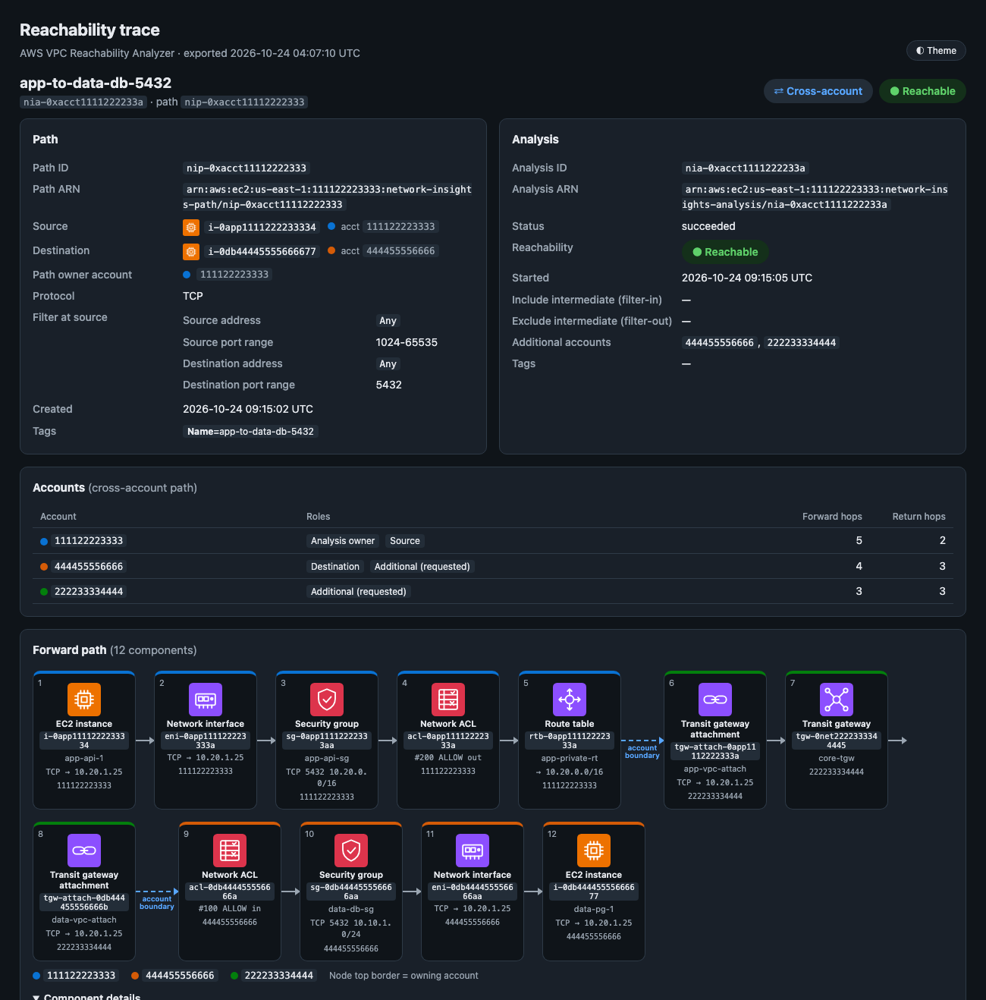

# Reachability Trace

CLI for AWS VPC Reachability Analyzer (EC2 Network Insights). Creates paths between any supported
source and destination, runs analyses, prints hop-by-hop summaries, and exports traces to a single
self-contained HTML file with an icon-based path diagram and full component detail.

**Ports are applied at the source.** Source IP, source port range, and destination port range are
sent as `FilterAtSource`, so the packet header is defined where the traffic originates. That header
is checked against the source's outbound security group and network ACL rules, then carried (and
transformed by NAT, load balancers, and so on) hop by hop, so inbound rules downstream see the same
flow. The top-level `SourceIp` and `DestinationPort` fields are never used; the API doesn't allow them
together with `FilterAtSource`.



> Screenshots in this README are simulated: they are exports rendered from the synthetic fixtures in
> `tests/fixtures/` (placeholder account `111122223333`), not from a live AWS account.

## Usage

HTML reports are written by default. Each analysis gets its own file under the reports folder,
organized by date and account:

```text
reports/
└── 2026-10-23/                                      # analysis start date (UTC)
    └── 111122223333/                                # account that owns the analysis (from its ARN)
        ├── app-to-db-5432_nia-0fedcba9876543210.html  # <Name tag>_<analysis-id>.html
        └── nia-0ccc000000000ccc3.html                 # no Name tag
```

- The root is `./reports` relative to the current directory. Change it with `--reports-dir` or `RA_REPORTS_DIR`.
- The file name uses the analysis `Name` tag, then the path `Name` tag, then just the analysis ID.
- The account is read from the analysis ARN, never from your local AWS profile. Re-exporting an analysis
  overwrites the same file.
- `create`/`analyze` wait for the analysis to finish and then write the report. `--export FILE` writes to that
  file instead. `--no-report` skips the report and returns as soon as the analysis starts (unless `--wait`
  or `--json-out` is also given).
- `export` without `-o` writes one report per analysis into the reports folder. `-o FILE` writes one combined
  file.
- `reports/` is git-ignored.


```bash
# Dry-run (default: prints the API requests, makes no changes)
python reachability.py create -s i-0abc... -d i-0def... --dest-port 5432

# Create path + run analysis, wait, write HTML report to reports/<date>/<account>/
python reachability.py create --execute -s i-0abc... -d i-0def... \
    --protocol tcp --dest-port 5432 --source-port 1024-65535 --source-ip 10.0.1.15 \
    --name app-to-db

# IP address destination, report written to a specific file instead
python reachability.py create --apply -s eni-0abc... --dest-ip 8.8.8.8 -p udp --dest-port 53 --export dns.html

# Re-run an existing path through a specific transit gateway, no report, don't wait
python reachability.py analyze nip-0123... --execute \
    --filter-in arn:aws:ec2:us-east-1:111122223333:transit-gateway/tgw-0abc... --no-report

# Inspect / export
python reachability.py paths
python reachability.py analyses --path-id nip-0123...
python reachability.py show nia-0123...
python reachability.py export nia-0123... nia-0456...                  # one report each, in reports/
python reachability.py export nia-0123... nia-0456... -o traces.html --json-out traces.json   # one combined file
python reachability.py export --from-json traces.json                  # offline re-render into reports/

# Cleanup (dry-run unless --execute)
python reachability.py delete-path nip-0123... --with-analyses --execute
python reachability.py delete-analysis nia-0123... --execute

# Supported types
python reachability.py types
```

Global options (`--profile`, `--region`, `-v`, `-q`) go **after** the subcommand, for example
`python reachability.py show nia-0123... --profile prod -q`.

Run the script from this directory or by path. It imports the sibling `ra_*.py` modules.

### Example summary output

`show`, and finished `create`/`analyze` runs, print a hop-by-hop summary. For cross-account paths every hop is
tagged with its owning `<account>`. For blocked paths, `xx` lines mark where the trace stops, the blocking
component and explanation code, and the endpoint that wasn't reached. A blocking hop that AWS returned is tagged
`<< BLOCKED`. These examples come from `tests/fixtures/`:

```text
Analysis nia-0xacct1111222233a  (path nip-0xacct11112222333)
  i-0app1111222233334 -> arn:aws:ec2:us-east-1:444455556666:instance/i-0db44445555666677  TCP
  Accounts: owner=111122223333 source=111122223333 destination=444455556666  [CROSS-ACCOUNT]
    111122223333: Analysis owner, Source; forward hops 5, return hops 2
    444455556666: Destination, Additional (requested); forward hops 4, return hops 3
    222233334444: Additional (requested); forward hops 3, return hops 3
  filter@source: src=any:1024-65535 dst=any:5432
  Status: succeeded  Result: REACHABLE
  Forward path:
    1. EC2 instance                 i-0app1111222233334 (app-api-1)  <111122223333>
    2. Network interface            eni-0app111122223333a  <111122223333>
    3. Security group               sg-0app11112222333aa (app-api-sg)  [egress TCP 5432 10.20.0.0/16]  <111122223333>
    4. Network ACL                  acl-0app11112222333a  [rule 200 egress ALLOW TCP 5432 10.20.0.0/16]  <111122223333>
    5. Route table                  rtb-0app11112222333a (app-private-rt)  [10.20.0.0/16 -> tgw-0net2222333344445]  <111122223333>
    6. Transit gateway attachment   tgw-attach-0app11112222333a (app-vpc-attach)  <222233334444>
    7. Transit gateway              tgw-0net2222333344445 (core-tgw)  <222233334444>
    8. Transit gateway attachment   tgw-attach-0db444455556666b (data-vpc-attach)  <222233334444>
    9. Network ACL                  acl-0db444455556666a  [rule 100 ingress ALLOW TCP 5432 10.10.0.0/16]  <444455556666>
   10. Security group               sg-0db444455556666aa (data-db-sg)  [ingress TCP 5432 10.10.1.0/24]  <444455556666>
   11. Network interface            eni-0db444455556666aa  <444455556666>
   12. EC2 instance                 i-0db44445555666677 (data-pg-1)  <444455556666>
  Return path:
    1. Network interface            eni-0db444455556666aa  <444455556666>
    2. Network ACL                  acl-0db444455556666a  [rule 110 egress ALLOW TCP 1024-65535 10.10.0.0/16]  <444455556666>
    3. Route table                  rtb-0db444455556666a (data-private-rt)  [10.10.0.0/16 -> tgw-0net2222333344445]  <444455556666>
    4. Transit gateway attachment   tgw-attach-0db444455556666b (data-vpc-attach)  <222233334444>
    5. Transit gateway              tgw-0net2222333344445 (core-tgw)  <222233334444>
    6. Transit gateway attachment   tgw-attach-0app11112222333a (app-vpc-attach)  <222233334444>
    7. Network ACL                  acl-0app11112222333a  [rule 210 ingress ALLOW TCP 1024-65535 10.20.0.0/16]  <111122223333>
    8. Network interface            eni-0app111122223333a  <111122223333>

Analysis nia-0b10c4ed00000000a  (path nip-0b10c4ed000000001)
  i-0src00000000000a1 -> i-0dst00000000000b2  TCP
  Accounts: owner=111122223333 source=111122223333 destination=111122223333
  filter@source: src=10.0.1.15:1024-65535 dst=any:5432
  Status: succeeded  Result: NOT REACHABLE
  Forward path:
    1. EC2 instance                 i-0src00000000000a1 (app-server-1)
    2. Network interface            eni-0src0000000000a1
    3. Security group               sg-0app00000000000a1 (app-sg)  [egress All All (0-65535) 10.0.0.0/16]
    4. Network ACL                  acl-0a0000000000000a1  [rule 100 egress ALLOW All All 0.0.0.0/0]
    5. Route table                  rtb-0a0000000000000a1 (app-rt)  [10.0.0.0/16 -> local]
    6. Network ACL                  acl-0b0000000000000b2  [rule 110 ingress ALLOW TCP 5432 10.0.1.0/24]
    xx path stops after hop 6
    xx BLOCKED at sg-0db000000000000b2 (ENI_SG_RULES_MISMATCH)
    xx destination not reached: i-0dst00000000000b2
  Explanation: ENI_SG_RULES_MISMATCH sg-0db000000000000b2 ingress
```

### Commands

| Command | Mutates | Description |
|---|---|---|
| `types` | no | List supported source/destination and intermediate types |
| `create` | yes | Create a path, start an analysis, wait, write the report (`--no-analyze` creates the path only) |
| `analyze PATH_ID` | yes | Start a new analysis on an existing path, wait, write the report |
| `paths` | no | List paths (`--json`) |
| `analyses` | no | List analyses (newest first), optionally for one path (`--path-id`, `--json`) |
| `show ANALYSIS_ID` | no | Print a hop-by-hop summary (`--json` for the raw bundle) |
| `export ID...` | no | Write one HTML report per analysis to the reports folder, or one combined file with `-o FILE`. `--from-json` re-renders saved bundles offline. `--wait` waits for running analyses first |
| `delete-path` / `delete-analysis` | yes | Delete resources. `delete-path --with-analyses` also deletes the path's analyses |

### Options

| Flag | Description |
|---|---|
| `--execute` / `--apply` | Apply changes (default: dry-run) |
| `--profile NAME` | AWS profile (overrides `AWS_PROFILE`). Never included in exports |
| `--region REGION` | AWS region (default `AWS_REGION`, then `AWS_DEFAULT_REGION`, then the profile's region; errors if none) |
| `-s/--source` | Source ID or ARN (use an ARN for cross-account resources) |
| `-d/--dest` | Destination ID or ARN |
| `--dest-ip` | Destination IPv4 (alone, or to pick one IP on `--dest`) |
| `--source-ip` | Source IPv4, applied at source |
| `-p/--protocol` | `tcp` (default) or `udp` |
| `--dest-port` / `--source-port` | Port or range (`443`, `1024-65535`), applied at source |
| `--name`, `--tag K=V` | Path tags |
| `--filter-in ARN` / `--filter-out ARN` | Include/exclude an intermediate component (repeatable) |
| `--additional-account ID` | Extra account for cross-account analysis (repeatable) |
| `--analysis-name` | Name tag for the analysis |
| `--wait`, `--timeout N` | Wait for the analysis to finish (`create`/`analyze` default `RA_WAIT_TIMEOUT` or 600s; `export --timeout` default 600s) |
| `--reports-dir DIR` | Reports root (default `RA_REPORTS_DIR` or `./reports`). Files go to `DIR/<YYYY-MM-DD>/<account-id>/` |
| `--export FILE.html` | `create`/`analyze`: write the report to this file instead of the reports folder |
| `--no-report` | `create`/`analyze`: skip the HTML report, and don't wait unless `--wait`/`--json-out` is given |
| `--theme dark\|light\|auto` | HTML report theme (default `RA_THEME` or `dark`). `auto` follows the OS. Each report also has an in-page toggle |
| `--no-auto-accounts` | `create`/`analyze`: don't add source/destination/filter ARN accounts to `AdditionalAccounts` |
| `-o/--output FILE.html` | `export`: write one combined file instead of per-analysis reports |
| `--json-out FILE.json` | Also save the path+analysis JSON bundle(s) (`create`/`analyze` wait first) |
| `--title TEXT` | Page title for the HTML export (default "Reachability Trace") |
| `--check-permissions` | In dry-run, call the API with `DryRun=True` to check IAM permissions (`create`/`analyze`) |
| `-v` / `-q` | Debug / warnings-only logging |

### Supported types

| Source / destination | ID prefix |
|---|---|
| EC2 instance | `i-` |
| Internet gateway | `igw-` |
| Network interface | `eni-` |
| Transit gateway | `tgw-` |
| Transit gateway attachment | `tgw-attach-` |
| Virtual private gateway | `vgw-` |
| VPC endpoint service | `vpce-svc-` |
| VPC endpoint | `vpce-` |
| VPC peering connection | `pcx-` |
| IP address (destination only) | `--dest-ip` |

Intermediate components for `--filter-in` / `--filter-out` (ARNs): load balancers, NAT gateways,
Network Firewall firewalls, transit gateways, transit gateway attachments, VPC peering connections.

## HTML export

Reports open in **dark mode** by default. Use `--theme light` or `--theme auto` (follow the OS), or set
`RA_THEME`. A ◐ Theme button in each report switches between dark and light, and printing always uses light.

| Dark (default) | Light |
|---|---|
|  |  |

One `.html` file with no external assets: inline CSS, inline SVG icons, and a few lines of inline JavaScript
for the theme toggle. It's print-friendly. Multiple analyses go in one file with a jump bar. For each analysis it shows:

- **Path**: ID/ARN, source and destination (with icons and owning accounts), path owner account, protocol,
  filter at source/destination, created date, tags
- **Analysis**: ID/ARN, status, reachable/not-reachable badge, status and warning messages, filter-in/out ARNs,
  additional and suggested accounts, tags
- **Accounts**: every account involved, with its roles (analysis owner, source, destination, additional,
  suggested by AWS, filter component, in explanations) and how many forward/return hops it owns
- **Forward and return path diagrams**: one icon card per component with its sequence number, type, ID, name, and a
  short rule/route hint. Click a card to jump to its details
- **Account on every hop**: each component's details show its owning account (from its ARN, else its VPC/subnet)
- **Component details**: VPC, subnet, attached-to, source/destination VPC, transit gateway, inbound/outbound packet
  headers, security group rule, network ACL rule, route table route, TGW route and policy entry, ELB listener,
  Network Firewall stateless/stateful rules, additional details, and per-component explanations
- **Explanations**: each explanation code with the AWS description and every field returned. Blocked paths also get
  a breakpoint banner and markers in the diagram (see [Blocked paths](#blocked-paths))
- **Alternate path hints** and the **raw API JSON**

Return path: shown whenever AWS returns return-path components. Each hop shows the reversed packet
header and the rules that admit the reply traffic, such as the ephemeral-port NACL rule below:



### Blocked paths

When a path isn't reachable, the report still shows **every hop AWS returned**, each with its details card. The
break is marked prominently:

- A red banner at the top of the broken direction: "Path blocked … after hop N", with each blocking component,
  its explanation code, and the AWS description. Each blocker links to its details card, or to the Explanations
  card if it isn't one of the hops.
- In the diagram, the last returned hop is followed by a red **✕** break, then the blocking component(s) in red
  with a **BLOCKED** label and code, another **✕**, and the endpoint that was never reached, dimmed and labelled
  *not reached*.
- If a blocker is one of the returned hops, that node is outlined in red with **BLOCKED** and its code, and its
  details card gets a **⛔ BLOCKING** pill.
- If the forward path reached the destination but the reply didn't make it back, the break is drawn on the
  **return path** instead, ending at the source (*reply not reached*).
- If AWS returned no hops, the diagram starts at the source and shows the break and the blockers.
- The Analysis card adds a **Blocked at** row.

A blocker is the explanation's `Component`. If that's missing, it's the most specific component the explanation
names (ACL, security group, route table, gateway, and so on). Context fields such as VPC and subnet are never
marked as blockers.



Explanations show every code with the AWS description and every field returned:



Internet gateway → Network Load Balancer → instance, showing per-hop packet headers and address translation:



The export includes only data returned by the EC2 API. The AWS profile name and credentials are never written.

## Cross-account paths

Sources and destinations are often in different accounts, for example an app account reaching a database
account through a transit gateway owned by a network account. Reachability Analyzer supports this for accounts
in the same AWS Organization once trusted access is enabled. Paths and analyses are created in the account you
run as (the **path owner**), typically the management account or a delegated administrator. See
[Cross-account analyses](https://docs.aws.amazon.com/vpc/latest/reachability/multi-account.html).

**Running them**

- Give resources in other accounts as **ARNs** (`-s`/`-d`, `--filter-in`/`--filter-out`). A bare ID is looked up in
  the path owner's account.
- `create` and `analyze` automatically add every account in the source, destination, and filter ARNs that isn't the
  path owner to `AdditionalAccounts`, and log which ones they added. Add others (such as a network account that only
  owns a transit gateway in the middle) with `--additional-account`. Turn the automatic part off with
  `--no-auto-accounts`.
- If AWS returns `SuggestedAccounts` that weren't included, the CLI logs a warning with the exact
  `--additional-account` flags to re-run with, and the report repeats it.

```bash
python reachability.py create --execute \
    -s arn:aws:ec2:us-east-1:111122223333:instance/i-0app... \
    -d arn:aws:ec2:us-east-1:444455556666:instance/i-0db... \
    --additional-account 222233334444 --dest-port 5432 --name app-to-data-db-5432
```

**What's reported**

- A **⇄ Cross-account** badge when the path owner, source, destination, and traversed hops span more than one account.
  Accounts that were only requested or suggested don't count.
- The **Accounts** card: each account's roles and forward/return hop counts.
- In the diagrams, each node shows its account with a per-account color on its top border (legend below). Dashed
  **account boundary** links mark every point where traffic moves to a different account.
- Each component's details show its owning account.
- The CLI summary adds an `Accounts:` line, a per-account breakdown, and `<account>` on each hop.



Reports are filed under the **path owner's** account (`reports/<date>/<owner-account>/`), since that's where the
analysis lives and can be re-run. The source and destination accounts are inside the report.

## Requirements

- Python 3.11+
- AWS credentials configured (profile, env vars, SSO, or IAM role)

## Installation

```bash
python3 -m venv .venv && . .venv/bin/activate
pip install -r requirements.txt
```

## Configuration

Copy `.env.example` to `.env` and fill in values. `.env` is searched for starting in this directory and
then its parent directories. CLI flags override `.env` values.

| Variable | Default | Description |
|---|---|---|
| `AWS_PROFILE` | (default chain) | AWS profile name |
| `AWS_REGION` | profile region | Target region |
| `AWS_DEFAULT_REGION` | — | Region fallback when `AWS_REGION` is unset |
| `RA_WAIT_TIMEOUT` | `600` | Default `--timeout` for `create` and `analyze` (not `export`) |
| `RA_REPORTS_DIR` | `reports` | Root folder for HTML reports |
| `RA_THEME` | `dark` | Default report theme: `dark`, `light`, or `auto` |

## Platform Notes

- **macOS**: System PKI truststore used automatically via Security.framework. No extra cert config needed.
- **Windows**: System Certificate Store used automatically. Credentials at `%USERPROFILE%\.aws\credentials`.
- **Linux**: System CA bundle used via `truststore`. Ensure `ca-certificates` is installed.

## IAM Permissions

```json
{
  "Version": "2012-10-17",
  "Statement": [
    {
      "Effect": "Allow",
      "Action": [
        "ec2:CreateNetworkInsightsPath",
        "ec2:StartNetworkInsightsAnalysis",
        "ec2:DescribeNetworkInsightsPaths",
        "ec2:DescribeNetworkInsightsAnalyses",
        "ec2:DeleteNetworkInsightsPath",
        "ec2:DeleteNetworkInsightsAnalysis",
        "ec2:CreateTags",
        "ec2:Describe*",
        "elasticloadbalancing:Describe*",
        "network-firewall:Describe*",
        "network-firewall:List*",
        "tiros:CreateQuery",
        "tiros:GetQueryAnswer",
        "tiros:GetQueryExplanation"
      ],
      "Resource": "*"
    }
  ]
}
```

Read-only use (`paths`, `analyses`, `show`, `export`) only needs the `Describe*` actions.
AWS charges for each analysis run. See AWS pricing.

## Output

- Mutating commands log `[DRY-RUN]` with the exact API request JSON unless `--execute`/`--apply` is passed,
  in which case they log `[EXECUTE]`. Dry-runs make no API calls, except `--check-permissions` and
  `delete-path --with-analyses`, which lists the path's analyses.
- Logs go to stderr. Results (summaries, listings, `--json`) go to stdout, so `--json` output can be piped.
- `show` and finished `create`/`analyze` runs print a hop-by-hop summary to stdout. `--json` prints raw API data.
- Each written report is logged as `Wrote HTML export <path>`.
- Dry-runs of `create`/`analyze` log where the report would go (`reports/<date>/<account>/<analysis>.html`).
- Exit codes: `0` success, `1` validation, credential, lookup, timeout, or AWS error, `2` analysis finished
  with status `failed` (argparse usage errors also exit `2`).

## Tests

```bash
pip install -r requirements-dev.txt
pytest tests
```

Tests cover input validation, `FilterAtSource` request building, dry-run safety (no API calls), icon
classification, account attribution and cross-account reporting, breakpoints on blocked paths (forward, return,
no hops, blocker in or outside the returned hops), themes, and HTML rendering against the fixtures in
`tests/fixtures/`.

### Regenerating the screenshots

The images in `docs/images/` are headless-Chrome captures of the fixture exports. Regenerate them all with
(macOS: needs Google Chrome and `sips`):

```bash
python docs/make_screenshots.py                 # all shots; --chrome PATH for another Chrome/Chromium binary
python docs/make_screenshots.py blocked-path    # just the named shot(s)
```

The script renders each fixture in the theme listed in its `SHOTS` table, measures the region to keep, captures it,
and crops it.
