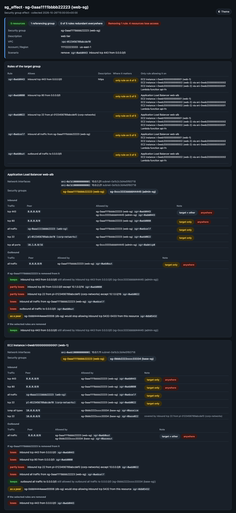
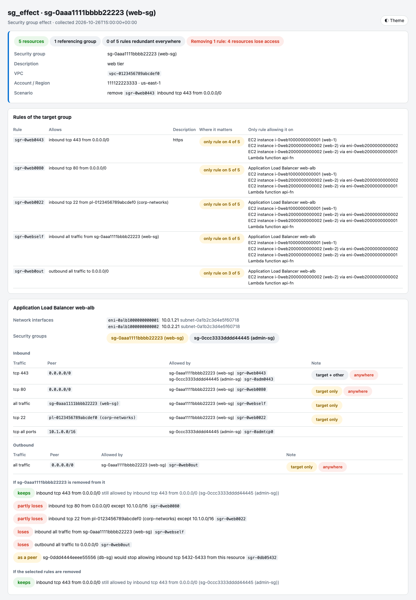

# SG Effect

Give it a security group ID. It finds every resource that uses the group (EC2 instances, load balancers, Lambda
functions, RDS, VPC endpoints, ECS tasks, EFS and more) and shows what the group really does on each one,
after counting every other security group on that resource:

- **Effective access:** the resource's net inbound and outbound access, merged across all of its groups. Each
  entry shows the group(s) and rule(s) that allow it, marks what only the target group allows, and notes
  rules already covered by a broader one.
- **If the group is removed:** what the resource would lose if the target group were taken off it. It counts
  the part of each rule that no other group allows, plus access that other groups grant to the target
  group's members.
- **If rules are removed** (`--remove-rule`): what each resource would lose if those rules of the target group
  were deleted, and for the access it keeps, which rule still allows it.
- **Rule summary:** for each rule of the target group, the resources where it's the only rule allowing that
  traffic. A rule that's redundant everywhere can be deleted without changing any access.
- **Referencing groups:** the security groups whose rules point at the target group, and the resources
  behind them.

The tool is read-only.



## Usage

```bash
# Every resource using the group, its effective access, and the cost of removing the group
python sg_effect.py sg-0aaa1111bbbb22223 --profile network-admin --region us-east-1

# What would deleting these rules break? (sgr- IDs, or DIRECTION:PROTOCOL:PORTS:PEER)
python sg_effect.py sg-0aaa1111bbbb22223 --remove-rule sgr-0web0443
python sg_effect.py sg-0aaa1111bbbb22223 --remove-rule in:tcp:22:pl-0123456789abcdef0 \
                                         --remove-rule out:-1:all:0.0.0.0/0

# One resource only (instance ID, load balancer or function name, or ENI ID)
python sg_effect.py sg-0aaa1111bbbb22223 --resource i-0web1000000000001

# Save the data once, then try scenarios offline
python sg_effect.py sg-0aaa1111bbbb22223 --json-out web-sg.json --no-report
python sg_effect.py --from-json web-sg.json --remove-rule sgr-0web0080
```

A rule spec is `DIRECTION:PROTOCOL:PORTS:PEER`:

| Part | Values |
|---|---|
| Direction | `in` / `out` (also `inbound`, `outbound`, `ingress`, `egress`) |
| Protocol | `tcp`, `udp`, `icmp`, `icmpv6`, `-1` or `all`, or a protocol number |
| Ports | `443`, `8000-8080`, or `all` (also for ICMP: `all` types, or the type number) |
| Peer | a CIDR, an `sg-` ID or a `pl-` ID |

It has to match a rule of the target group exactly. Use `--remove-rule` more than once to remove several rules
together.

### Example: one instance

The target `web-sg` allows HTTPS and HTTP from anywhere, SSH from the `corp-networks` prefix list (10.0.0.0/8
and 192.168.0.0/16), all traffic between its own members, and all outbound. The instance also has `base-sg`,
which allows SSH and ICMP from 10.0.0.0/8 and all outbound. `db-sg` allows 5432-5433 from `web-sg`, and 5433
from `base-sg`.

```text
$ python sg_effect.py sg-0aaa1111bbbb22223 --remove-rule sgr-0web0443
...
== EC2 instance i-0web1000000000001 (web-1)
   ENI eni-0web1000000000001  10.0.1.11  subnet-0a1b2c3d4e5f60718
   Groups: sg-0aaa1111bbbb22223 (web-sg) [target], sg-0bbb2222cccc33334 (base-sg)
   Inbound (6):
   * tcp 443 from 0.0.0.0/0                            sg-0aaa1111bbbb22223
   * tcp 80 from 0.0.0.0/0                             sg-0aaa1111bbbb22223
   * all traffic from sg-0aaa1111bbbb22223 (web-sg)    sg-0aaa1111bbbb22223
   * tcp 22 from pl-0123456789abcdef0 (corp-networks)  sg-0aaa1111bbbb22223
     icmp all types from 10.0.0.0/8                    sg-0bbb2222cccc33334
     tcp 22 from 10.0.0.0/8                            sg-0bbb2222cccc33334   (covered by inbound tcp 22 from pl-0123456789abcdef0 (corp-networks))
   Outbound (1):
   * all traffic to 0.0.0.0/0  sg-0aaa1111bbbb22223, sg-0bbb2222cccc33334
   If sg-0aaa1111bbbb22223 is removed from it:
     loses inbound tcp 443 from 0.0.0.0/0   [sgr-0web0443]
     loses inbound tcp 80 from 0.0.0.0/0   [sgr-0web0080]
     partly loses inbound tcp 22 from pl-0123456789abcdef0 (corp-networks) except 10.0.0.0/8   [sgr-0web0022]
     loses inbound all traffic from sg-0aaa1111bbbb22223 (web-sg)   [sgr-0webself]
     keeps outbound all traffic to 0.0.0.0/0   (still allowed by outbound all traffic to 0.0.0.0/0 [sg-0bbb2222cccc33334 (base-sg)])
     sg-0ddd4444eeee55556 (db-sg) would stop allowing inbound tcp 5432 from this resource
   If the selected rules are removed:
     loses inbound tcp 443 from 0.0.0.0/0   [sgr-0web0443]
```

`*` marks access the target group allows. A partial loss names what's still allowed: SSH from 10.0.0.0/8
survives through `base-sg`, so only 192.168.0.0/16 is lost. The database keeps accepting 5433 from this
instance through `base-sg`, so only 5432 is lost.

The end of the output summarizes each rule of the target group, and lists the groups that reference it:

```text
Target rules across 5 resources:
    sgr-0web0443  inbound tcp 443 from 0.0.0.0/0: only rule allowing it on 4, redundant on 1
    sgr-0web0080  inbound tcp 80 from 0.0.0.0/0: only rule allowing it on 5
    sgr-0web0022  inbound tcp 22 from pl-0123456789abcdef0 (corp-networks): only rule allowing it on 5
    sgr-0webself  inbound all traffic from sg-0aaa1111bbbb22223 (web-sg): only rule allowing it on 5
    sgr-0web0out  outbound all traffic to 0.0.0.0/0: only rule allowing it on 3, redundant on 2

Groups whose rules reference sg-0aaa1111bbbb22223:
    sg-0ddd4444eeee55556 (db-sg), used by 1 other resource:
      inbound tcp 5432-5433 from sg-0aaa1111bbbb22223 (web-sg)
```

## How it works

Security groups only allow traffic, so a resource's access in each direction is the union of every rule in
every group on its network interface. To find what removing something costs, each rule is treated as a block
of traffic:

- **Protocol:** `tcp`, `udp`, `icmp`, `icmpv6`, or another protocol by number. "All traffic" is all of them.
- **Ports:** a port range for TCP/UDP, a type range for ICMP.
- **Peers:** CIDR ranges. Prefix lists are expanded to their entries, so a `/8` in another group covers the
  matching part of a prefix list. A referenced security group is its own peer: it's covered only by a rule
  that references the same group.

The tool subtracts every rule that stays from every rule that goes. What's left is exactly the traffic that
would be lost, down to individual ports and address ranges. "Several rules together" means no single rule
covers the access, but the remaining rules do between them.

For a group that references the target (as in `db-sg` above), removing the target from a resource means
those rules stop matching it. The tool counts that loss unless the referencing group has a rule for another
of the resource's groups that covers the same traffic.

Resources are found through their network interfaces (`DescribeNetworkInterfaces` filtered by group). The
interface's attachment, type and description identify the owner. Interfaces of the same resource are grouped
together. If an instance has interfaces with different groups, each set is shown separately, because access
is per interface.

### What isn't considered

- Network ACLs, route tables and firewalls on the resource itself. The result is what security groups allow,
  not whether a path exists. Use `reachability_trace` for the path.
- The IP addresses behind a referenced group. A CIDR rule doesn't count as covering a group reference, even if
  the group's members sit inside the CIDR.
- A prefix list whose entries can't be read. It's treated as an opaque peer, with a warning.
- A referenced group in a peered VPC or another account that can't be read. It's shown by ID, with a
  warning.
- Hyperplane ENIs shared by several Lambda functions are labeled with the function in the ENI description.

## HTML report

Unless you pass `--no-report`, the tool writes a self-contained HTML report to
`reports/<YYYY-MM-DD>/<account>/sg-effect_<group>.html` (with `_remove-rules` when a scenario was given), or
to `--output`. It has the summary, the rules table, one card per resource with its inbound and outbound
tables and both scenarios, the referencing groups, warnings, and the raw bundle. `--theme dark|light|auto`
picks the look (default `dark`; `auto` follows the OS), and the button in the corner switches it.



## Requirements

- Python 3.11+
- AWS credentials configured (profile, env vars, SSO, or IAM role)

## Installation

```bash
pip install -r requirements.txt
```

See the [repository README](../../README.md#getting-started) for a shared virtual environment.

## Configuration

Copy `.env.example` to `.env` and fill in values (CLI flags override them). `.env` is read from this tool's
directory, or from the nearest parent directory that has one (such as the repository root). The directory you
run the tool from doesn't matter.

| Variable | Default | Description |
|---|---|---|
| `AWS_PROFILE` | (default chain) | AWS profile name (never written to reports) |
| `SGE_REGION` | `AWS_REGION` / `AWS_DEFAULT_REGION` | Region of the security group |
| `SGE_REPORTS_DIR` | `reports` | Reports root |
| `SGE_THEME` | `dark` | Default report theme (`dark`, `light`, `auto`) |

## IAM Permissions

All read-only:

```json
{
  "Version": "2012-10-17",
  "Statement": [
    {
      "Effect": "Allow",
      "Action": [
        "ec2:DescribeSecurityGroups",
        "ec2:DescribeSecurityGroupRules",
        "ec2:DescribeNetworkInterfaces",
        "ec2:DescribeManagedPrefixLists",
        "ec2:GetManagedPrefixListEntries",
        "ec2:DescribeInstances"
      ],
      "Resource": "*"
    }
  ]
}
```

## Output

- **stdout:** the text output above, or the full analysis as JSON with `--json`. `--json-out` saves the raw
  bundle for `--from-json`.
- **Logs (stderr):** `%(asctime)s %(levelname)s sg_effect — message`. A call that fails (a prefix list or
  group that can't be read) is a warning, shown in the output and the report; the rest continue.
- **Exit codes:** 0 on success. 1 for a bad group ID or rule spec, credential problems or a fatal AWS error.
  2 when the `--remove-rule` scenario takes access away from at least one resource, so a script can check
  that a cleanup is safe.

## Tests

```bash
pip install -r requirements-dev.txt
python -m pytest
```

No AWS credentials are needed. The tests use an in-memory fake of the EC2 calls with synthetic data
(`tests/fake_ec2.py`).

## Regenerating screenshots

```bash
python docs/make_screenshots.py           # all
python docs/make_screenshots.py report    # one
```

The images in `docs/images/` are headless-Chrome captures of a report built from the test data. This needs
macOS and Google Chrome.

## Platform Notes

- **macOS:** the system PKI truststore is used automatically through Security.framework (`truststore`).
- **Windows:** the Windows Certificate Store is used automatically. Credentials are at
  `%USERPROFILE%\.aws\credentials`.
- **Linux:** the system CA bundle is used through `truststore`. Make sure `ca-certificates` is installed.
